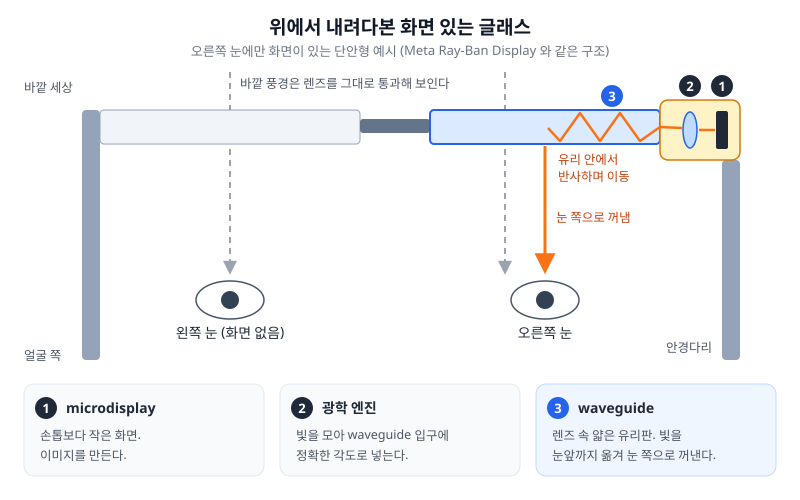
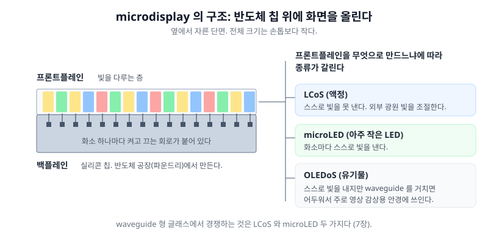
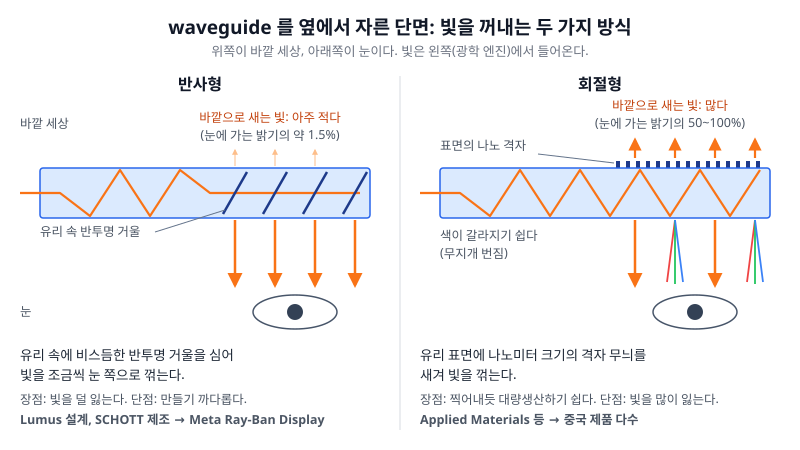
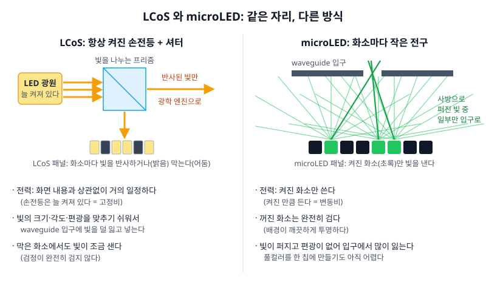
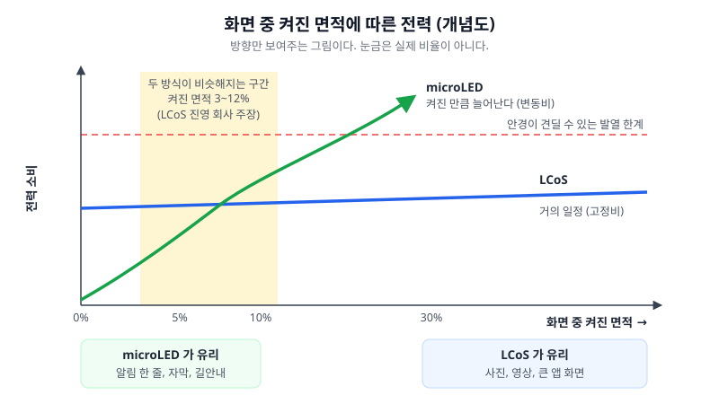
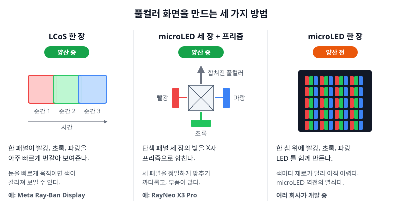
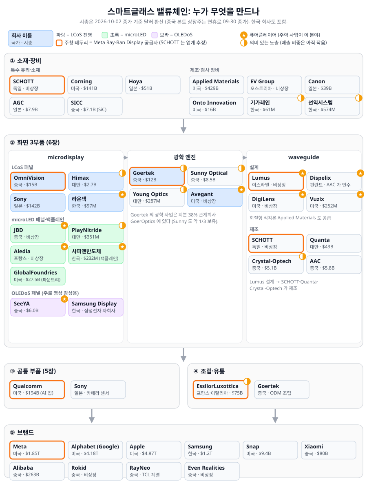

## 0. 이 글을 쓰는 이유

스마트글래스를 처음 공부하면서 네 가지가 궁금했다.

1. 지금 실제로 팔리는 것은 무엇이고, 얼마나 팔리나.
2. 시장이 본격적으로 열리는 시점은 언제인가.
3. 안경 한 대를 만들 때 돈은 어느 부품으로 흘러가나.
4. 화면을 만드는 기술 중 무엇이 미래가 될까.

이 글은 이 네 질문에 답하면서 산업 전체의 지도를 그린다. 이 지도를 투자 관점에서 읽는 이야기는 2편에서 이어간다.

### 결론 미리보기

1. **지금 팔리는 것은 화면이 없는 AI 글래스다.** 카메라, 스피커, 마이크만 달린 제품이 전체 대수의 83~96% 를 차지하고, 그 대부분이 Meta 브랜드(Ray-Ban Meta, Oakley Meta)다.
2. **화면 없는 글래스는 2025년에 변곡점을 지났다.** 1년 만에 판매가 3배 이상 늘어 700만 대를 넘었다. 화면 있는 글래스는 아직이고, 본격적으로 열릴 후보 시기는 2027~2028년이다. 2026년 가을부터는 AI agent(Meta Muse, Google Gemini)가 안경에 붙기 시작하면서, 안경을 사는 이유가 "카메라 달린 선글라스" 에서 "agent 의 눈과 귀" 로 바뀌고 있다.
3. **2030년 기기 시장은 기본 시나리오에서 약 $13B, 낙관 시나리오에서 약 $40B 이다.** 그리고 안경에 화면이 붙는 순간 가장 비싼 부품이 칩에서 광학 부품으로 바뀐다.
4. **화면은 세 부품(microdisplay, 광학 엔진, waveguide)이 함께 만든다.** 공급 병목이던 waveguide 는 제조사가 늘면서 풀리는 중이다.
5. **microdisplay 기술은 용도에 따라 갈린다.** 2028년 전후까지 풀컬러 화면 글래스는 LCoS, 텍스트용 단색 글래스는 microLED 가 가져갈 가능성이 높다. microLED 가 풀컬러까지 가져가는 시점은 2030년대 초로 본다.

### 근거 표시 읽는 법

이 글의 숫자에는 근거가 어디서 왔는지를 괄호로 붙였다.

| 표시 | 뜻 |
|---|---|
| **(공시)** | 회사가 규제기관(미국 SEC, 한국 DART, 중국 거래소 등)에 낸 서류로 확인한 숫자다. 가장 믿을 만하다. |
| **(회사 발표)** | 회사가 보도자료나 실적 발표에서 말한 숫자다. 자기 회사에 유리하게 말할 수 있다는 점을 감안하고 읽어야 한다. |
| **(조사기관·전문가)** | IDC, Counterpoint 같은 시장 조사기관이나 제품을 직접 분해한 분석가가 낸 숫자다. 기관마다 세는 기준이 달라서 숫자가 서로 다를 수 있다. |
| **(필자 추정)** | 내가 계산한 숫자다. 바로 아래에 계산 과정을 같이 적었다. |

기준일은 2026년 10월 초이고, 출처 링크는 글 끝에 모았다.

---

## 1. 스마트글래스는 두 종류다

**Q. VR 헤드셋(Meta Quest, Apple Vision Pro)과 뭐가 다른가?**

VR 헤드셋은 눈을 완전히 덮고 바깥을 가린 채 화면 속 세상을 보여주는 기기다. 무게가 수백 g 이라 집 안에서 잠깐씩 쓴다. 스마트글래스는 평범한 안경 모양이고, 하루 종일 쓰고 다니는 것을 목표로 한다. 바깥 풍경은 그대로 보이고, 그 위에 소리나 작은 정보를 더한다. 이 글은 스마트글래스만 다룬다.

스마트글래스는 화면이 있느냐 없느냐로 크게 둘로 나뉜다. 둘은 들어가는 핵심 부품이 완전히 달라서, 나눠서 봐야 시장 숫자와 공급망이 헷갈리지 않는다.

| 종류 | 무엇인가 | 대표 제품 | 핵심 부품 |
|---|---|---|---|
| **화면 없는 글래스** | 카메라, 스피커, 마이크가 달린 안경이다. 사진을 찍고, 음악을 듣고, AI 비서(Meta AI 등)에게 말로 묻는다. 눈앞에는 아무것도 보이지 않는다. | Ray-Ban Meta, Oakley Meta, Xiaomi AI 글래스 | AI 칩, 카메라, 배터리 |
| **화면 있는 글래스** | 안경 렌즈 속에 얇은 유리판(waveguide)을 넣어 눈앞에 글자나 이미지를 띄운다. 바깥 풍경도 그대로 보인다. 한쪽 눈에만 띄우는 단안형과 두 눈 모두에 띄우는 양안형이 있다. | Meta Ray-Ban Display($799, 단안), Rokid Glasses, Even G2, Snap Specs($2,195, 양안) | 위 부품 + microdisplay, 광학 엔진, waveguide |

폰이나 PC 에 선으로 연결해 눈앞에 큰 모니터를 띄우는 영상 감상용 안경(XREAL 등)도 있다. 다만 waveguide 를 쓰지 않아 구조와 공급망이 달라서 이 글에서는 다루지 않는다.

**Q. AR 글래스와 AI 글래스는 같은 말인가?**

엄밀히는 다르지만 섞여 쓰인다. AR(Augmented Reality, 증강현실) 글래스는 현실 위에 디지털 정보를 겹쳐 보여주는 안경, 즉 화면 있는 글래스를 가리키는 말이다. AI 글래스는 AI 비서가 핵심 기능인 안경을 가리키는데, 보통 화면 없는 글래스를 말한다. 다만 요즘은 화면 있는 글래스도 AI 비서를 중심으로 쓰이기 때문에, 조사기관에 따라 둘을 합쳐 "AI 글래스" 로 부르기도 한다.

---

## 2. 얼마나 팔리고, 누가 파나

### 2-1. 지금 시장은 사실상 Meta 다

| 지표 | 숫자 | 근거 |
|---|---|---|
| 2025년 전 세계 AI 글래스 출하 | 870만 대, 이 중 Meta 740만 대(85%) | Omdia, 2026-03 (조사기관·전문가) |
| 2026 Q2 스마트글래스·헤드셋 전체 중 Meta 점유율 | 68.7% | IDC, 2026-09 (조사기관·전문가) |
| 2026 상반기 화면 없는 AI 글래스 중 Meta 점유율 | 94% | Counterpoint, 2026-09 (조사기관·전문가) |

기관마다 무엇을 셌는지가 달라 Meta 점유율이 69~94% 로 갈린다. 어느 숫자를 써도 결론은 같다. 지금 스마트글래스 시장은 사실상 Meta 한 회사의 시장이다.

**Q. Meta 는 왜 이렇게 압도적인가?**

공개된 사실을 바탕으로 한 내 해석은 네 가지다.

1. **안경처럼 보이는 디자인이다.** Meta 는 Ray-Ban, Oakley 브랜드를 가진 세계 최대 안경 회사 EssilorLuxottica(이하 EL)와 함께 만든다. 기기처럼 보이지 않고 평범한 선글라스처럼 보인다는 점이 하루 종일 쓰는 제품에서 결정적이다.
2. **안경 유통망을 그대로 쓴다.** EL 의 안경 매장과 소매망에서 팔리고, 도수 렌즈도 EL 이 맞춰 준다. 전자제품 매장에서만 팔리는 기기와 출발선이 다르다.
3. **가격이 낮다.** 화면 없는 모델이 $249~449 다. 일반 브랜드 선글라스에 조금 더 얹은 가격대다.
4. **먼저 시작했다.** 2021년 첫 제품(Ray-Ban Stories)을 냈고, 2023년 Ray-Ban Meta 부터 AI 비서를 붙였다. 두 회사는 협력을 "다음 10년까지" 연장했다(회사 발표). Meta 가 EL 지분 약 3% 를 샀다는 언론 보도도 있지만, 공시로는 확인하지 못했다.

### 2-2. 판매 추이: 1년 만에 3배

Meta 는 대수를 따로 공개하지 않는다. 함께 만드는 EL 이 가끔 밝힌 숫자와 조사기관 비율로 추이를 맞춰 봤다.

| 기간 | 판매량 | 근거 |
|---|---|---|
| 2023-09 출시 ~ 2025-02 | 누적 약 200만 대 | EL (회사 발표) |
| **2025년** | **700만 대 이상** (2024년의 3배 이상) | EL 2025년 실적 발표 (회사 발표) |
| 2026 상반기 | 약 500만~640만 대 | (필자 추정) |

2026 상반기 숫자는 두 가지 방법으로 계산했다.

```
방법 1: Wellsenn 상반기 전체 출하 599만 대 x Meta 점유율 약 92%  ≈  550만 대

방법 2: Counterpoint 성장률로 역산
        2026 상반기 = 2025 상반기 x 3.6   (전년 대비 +260%)
        2026 상반기 = 2025 하반기 x 1.22  (직전 반기 대비 +22%)
        2025 상반기 + 2025 하반기 = 700만 대
        → 2025 상반기 ≈ 177만, 2025 하반기 ≈ 523만, 2026 상반기 ≈ 640만 대
```
- Meta 점유율 92% = 화면 없는 시장 점유율 94% x 그 시장 비중 96% + 화면 있는 시장 점유율 37% x 그 시장 비중 4%.
- 두 방법의 차이는 EL 의 "판매" 기준과 조사기관의 "출하" 기준이 다르기 때문에 생긴다.

이 궤적은 AirPods 초기와 비슷하다.

| | 1년차 | 2년차 | 3년차 |
|---|---|---|---|
| AirPods | 2017년 약 1,500만 개 | 2018년 약 3,500만 개 | 2019년 약 6,000만 개 |
| Ray-Ban Meta | 2024년 약 200만 대 이하 | 2025년 700만 대 이상 | 2026년 약 1,100만~1,400만 대 (필자 추정) |

AirPods 숫자는 Bloomberg 등 언론이 전한 업계 추정치다. Ray-Ban Meta 는 규모가 AirPods 의 약 1/5 이지만, 해마다 2~3배씩 커지는 비슷한 구간에 들어와 있다.

다만 경고 신호도 있다. IDC 기준으로 스마트글래스·헤드셋 전체 성장률이 2026년 1분기 +130% 에서 2분기 +35% 로 꺾였다(조사기관·전문가). IDC 는 작년 같은 분기 숫자가 이미 컸던 데다, 신제품이 나오기 전 공백기였기 때문이라고 설명한다. 그리고 2027년 성장률을 +40.5% 로 전망한다.

### 2-3. 돈은 누가 버나

**Q. 매출은 누가 가져가나?**

처음 공부할 때 가장 헷갈렸던 부분이다. "스마트글래스 매출 = Meta 매출" 이 아니다.

1. Meta 는 연차보고서에서 하드웨어 사업부(Reality Labs)의 매출을 "Quest 와 AI 글래스 같은 하드웨어를 고객에게 인도할 때 생기는 매출" 로 정의한다. 판매 채널은 소매점, 리셀러, Meta 온라인몰, Meta 매장이라고 적는다(공시). 즉 Meta 가 직접 판 몫만 Meta 매출이 된다.
2. 그런데 Reality Labs 의 2025년 매출은 VR 헤드셋 Quest 까지 합쳐 $2.21B 에 불과하다(공시). 안경 700만 대에 소매가 $299~379 를 곱하면 소매가 기준으로만 $2B 가 넘는다. 따라서 안경 판매 매출의 대부분이 Meta 장부에 있을 수는 없다.
3. 결국 판매 매출의 대부분은 제조와 유통을 맡은 EL 에 잡힌다. EL 은 안경 매출을 유로 금액으로 공개하지 않는다. 판매 대수와 "그룹 성장률 중 몇 %p 가 안경에서 나왔다" 는 발표를 거꾸로 계산하면, 2025년 약 €1.5~2.0B, 2026년 약 €2.5~3.2B 로 추정된다(필자 추정). EL 그룹 매출의 5~10% 수준이다.

Meta 와 EL 이 수익을 어떻게 나누는지는 공개되지 않았다.

**Q. Meta 는 적자인데 왜 계속하나?**

Meta 의 하드웨어 사업부는 2026년 2분기 한 분기에만 영업손실 $4.62B 를 냈다(공시). 안경으로 돈을 벌고 있지 않다는 뜻이다. 그런데도 계속하는 이유는 바로 다음 절의 AI agent 와 연결된다. 내 해석으로는, 스마트폰 다음에 사람들이 하루 종일 몸에 지니는 기기, 그리고 AI 비서를 부르는 입구를 먼저 차지하려는 전략 투자다. 스마트폰 시대에 Meta 는 기기와 운영체제를 Apple 과 Google 에 의존해야 했는데, 다음 기기에서는 그 자리를 직접 가지려는 것이다. 반응도 나쁘지 않다. Meta 부사장 Jason Hartlove 는 화면 있는 모델(Ray-Ban Display)의 판매가 내부 기대를 300% 넘게 웃돌았다고 말했다(회사 발표).

### 2-4. AI agent 가 안경을 부른다

**Q. 요즘 나오는 AI agent 는 안경과 무슨 관계인가?**

AI agent 는 질문에 답만 하는 챗봇에서 한 걸음 더 나아가, 예약하고, 가격을 비교하고, 물건을 사는 일까지 대신 처리해 주는 AI 다. 2026년 가을, 이 agent 가 안경과 본격적으로 엮이기 시작했다.

| 시점 | 사건 | 근거 |
|---|---|---|
| 2026-09-08 | Meta 가 개인 AI agent "Muse" 출시. 휴대폰, 컴퓨터, 웹을 넘나들며 일을 대신 처리한다. | (회사 발표) |
| 2026-09 | Muse 가 미국에서 출시 22일 만에 다운로드 500만 돌파. 같은 숫자에 ChatGPT 는 56일, Grok 은 103일 걸렸다. | 앱 분석 집계를 인용한 Forbes·9to5Mac 보도 (조사기관·전문가) |
| 2026-09-23 | Meta Connect 2026 에서 Muse 를 행사 중심에 놓고, "곧 AI 글래스에서 Muse 를 부르면 지금 보고 있는 것을 바탕으로 일을 처리해 준다" 고 발표. 예시는 매장 진열대의 물건을 보고 묻고 바로 구매하기. 출시 날짜는 밝히지 않았다. | (회사 발표) |
| 2026-09 | Google 이 Gemini 를 넣은 화면 없는 글래스(Gentle Monster, Warby Parker 브랜드)를 올해 출시한다고 밝힘. 통역, 길안내, 눈앞 사물에 대한 질문 응답을 내세웠다. Qualcomm 은 글래스를 "주변을 감지하고 의도를 이해하는 AI agent 기기" 로 소개했다. | Snapdragon Summit 2026 (회사 발표) |

**왜 안경이 agent 에 맞는 기기인가.** 내 해석은 세 가지다.

1. **agent 는 맥락이 많을수록 일을 잘한다.** 내가 지금 무엇을 보고 무엇을 듣는지가 가장 좋은 맥락인데, 눈높이의 카메라와 귀 옆의 마이크가 폰을 꺼내지 않고도 그 맥락을 그대로 전달한다.
2. **손이 자유롭다.** 말로 시키고 소리로 듣는다. 운전, 요리, 운동 중에도 쓸 수 있다. Meta 도 정확히 이 장면들을 예시로 들었다.
3. **Meta 입장에서는 폰을 우회하는 길이다.** agent 를 폰 앱으로만 내놓으면 Apple 과 Google 이 정한 규칙 안에서 움직여야 한다. 안경은 Meta 가 기기부터 직접 쥐는 입구다.

이 흐름은 밸류체인을 읽는 방식도 바꾼다. 안경을 사는 이유가 "카메라 달린 선글라스" 에서 "agent 의 눈과 귀" 로 바뀌면, 수요를 끄는 힘은 하드웨어 사양이 아니라 AI 서비스가 된다.

**다만 반대 신호도 있다.**

1. **agent 가 꼭 안경에 있을 필요는 없다.** Meta 는 같은 행사에서 열쇠고리 크기의 Muse 전용 기기 "Charm" 을 12월에 내놓겠다고 했다. 안경을 쓰지 않을 때 Muse 를 부르는 가장 빠른 방법이라는 설명이다(회사 발표). agent 가 성공해도 그 수요가 안경으로만 가는 것은 아니라는 뜻이다.
2. **Muse 가 안경에 들어오는 날짜가 아직 정해지지 않았다.** 다운로드 숫자는 폰 앱 기준이다.
3. **항상 켜진 카메라는 사생활 논란을 부른다.** agent 가 "보고 있는 것" 을 활용할수록 이 문제는 커진다.

그래서 이 흐름은 3장의 체크포인트로도 이어진다. Muse 가 실제로 안경에 들어오는 시점, 그리고 Muse 사용 중 안경을 통한 사용이 얼마나 되는지가 다음에 확인할 숫자다.

### 2-5. 숫자를 읽을 때 주의할 점

**Q. 조사기관마다 숫자가 왜 다른가?**

같은 시장인데 Meta 점유율이 69%, 85%, 94% 로 나오고, 화면 있는 제품의 비중도 4% 와 17% 로 갈린다. 이유는 세 가지다.

1. **무엇을 셌는지가 다르다.** 어떤 기관은 화면 없는 AI 글래스만 세고, 어떤 기관은 VR 헤드셋까지 합쳐서 센다. 또 어떤 기관은 1장에서 제외한 영상 감상용 안경(XREAL 등)을 "화면 있는 글래스" 에 넣는다. 예를 들어 Counterpoint 는 화면 있는 AI 글래스 비중을 4% 로 보고, IDC 는 영상 감상용까지 넣어 안경 중 약 17% 로 본다(조사기관·전문가).
2. **"출하" 와 "판매" 가 다르다.** 조사기관은 공장에서 유통망으로 나간 대수(출하)를 세고, 회사는 소비자에게 팔린 대수(판매)를 말하는 경우가 많다.
3. **추정 방법이 다르다.** 회사가 대수를 공개하지 않으니 조사기관마다 부품 주문, 유통 데이터 등으로 추정한다.

그래서 이 글에서는 한 기관 숫자에 기대지 않고, 여러 기관 숫자를 나란히 놓거나 정의를 명시한다.

**Q. 중국은 어디쯤인가?**

시장에 따라 다르다.

| 시장 | 상황 | 근거 |
|---|---|---|
| 화면 없는 AI 글래스 | Meta 94%, Xiaomi 1%, Alibaba 1%. 중국 브랜드는 아직 존재감이 작다. | Counterpoint 2026 상반기 (조사기관·전문가) |
| 화면 있는 AI 글래스 | Rokid 41%, Meta 37%, Even Realities 11%, Alibaba 7%, INMO 2%. 출하의 45% 가 중국이다. 이 시장에서는 Meta 가 1등이 아니다. | Counterpoint 2026 상반기 (조사기관·전문가) |

화면 있는 시장에서 중국 브랜드가 앞서는 이유는 7장에서 다룬다. 짧게 말하면, 중국 업체들은 글자 표시용 단색(녹색) 화면을 싸고 작게 만드는 기술(microLED)로 먼저 제품을 내놓았다. 다만 화면 있는 시장 자체가 아직 작아서, 몇만 대 차이로 순위가 바뀔 수 있다.

---

## 3. 언제 대중화되나

**Q. 이미 터진 건가?**

화면 없는 글래스는 2025년에 변곡점을 지났다고 본다. 근거는 두 가지다.

1. **얼리어답터 장난감 수준을 넘었다.** 1년 만에 판매가 3배 넘게 늘어 700만 대를 넘었다(2장). 기기 하나가 연 수백만 대 단위로 팔리기 시작하면, 신기한 물건을 먼저 사 보는 사람들만으로는 설명이 안 되는 규모다.
2. **일반 안경 매장에서 팔린다.** 전자제품을 찾는 사람이 아니라 선글라스를 사러 온 사람이 집어 드는 제품이 됐다. 2장에서 본 EL 유통망 덕분이다.

다만 "ChatGPT moment" 처럼 어느 날 갑자기 모두가 쓰게 되는 장면은 기대하기 어렵다. ChatGPT 는 링크 하나만 누르면 써 볼 수 있었지만, 안경은 돈을 내고 사서 얼굴에 써야 한다. 그래서 하드웨어는 보통 2~3세대에 걸쳐 S자 곡선(처음엔 느리게, 중간에 가파르게, 끝에 다시 완만하게 느는 모양)으로 올라간다. iPhone 도 첫 제품(2007)보다 App Store 가 붙은 iPhone 3G(2008) 이후에 본격적으로 커졌다. 안경에서 App Store 역할을 할 후보가 2-4 에서 본 AI agent 다.

**Q. 화면 있는 글래스는 언제 나오나?**

이미 나와 있지만 아직 작다. AI 글래스 중 화면 있는 제품은 4% 이고(Counterpoint, 조사기관·전문가), Meta 의 첫 화면 모델 Ray-Ban Display 는 2026년 상반기에 약 9만 대 팔린 것으로 추정한다(필자 추정).

```
Meta Ray-Ban Display 2026 상반기
  = Wellsenn 상반기 전체 출하 599만 대 x 화면 있는 제품 비중 4% x 그중 Meta 점유율 37%
  ≈ 9만 대
```

화면 있는 글래스가 본격적으로 열릴 후보 시기는 2027~2028년이다. 이유는 큰 회사들의 제품이 이 시기에 몰려 있기 때문이다.

| 시점 | 제품 | 화면 | 근거 |
|---|---|---|---|
| 2026-06 | Snap Specs($2,195, 양안) | 있음 | (회사 발표) |
| 2026 하반기 | Google 의 Gemini 글래스(Gentle Monster, Warby Parker 디자인) | 없음 | (회사 발표) |
| 2027 | Apple 첫 글래스 | 없음 | 애널리스트 Ming-Chi Kuo (조사기관·전문가) |
| 2027 하반기 | Meta 고가 양안 AR 글래스 | 있음 | 업계 매체 보도. 회사 확인은 없다. |
| 2027 하반기~2028 상반기 | Samsung·Google 화면 글래스 | 있음 | 업계 매체 보도. 회사 확인은 없다. |
| 2029 이후 | Apple waveguide 화면 글래스 | 있음 | 애널리스트 Ming-Chi Kuo (조사기관·전문가) |

이 표에서 읽히는 것은 두 가지다.

1. **큰 회사들도 화면 없는 제품부터 낸다.** Google 과 Apple 모두 첫 제품은 화면이 없다. 화면 없는 제품이 이미 팔린다는 것이 Meta 로 증명됐고, 화면을 넣으면 가격과 무게가 크게 올라가기 때문이다.
2. **화면 있는 제품은 2027 하반기부터 몰린다.** Meta, Samsung, Google 이 같은 시기에 화면 있는 제품을 낸다면, 부품 회사 입장에서는 고객이 한 곳에서 여러 곳으로 늘어나는 시점이 된다. 같은 시기에 waveguide 제조사도 늘고 있다(8장).

참고로 업계 매체 보도처럼 회사가 확인하지 않은 일정은 근거 표시 없이 "보도" 라고만 적었다. 출시 일정은 자주 밀린다는 점을 감안하고 읽어야 한다.

**Q. AI agent 가 붙으면 화면이 더 필요해지나?**

두 방향 모두 가능하다. 내 해석은 이렇다. agent 가 물건을 사거나 예약을 대신할수록, 결과를 눈으로 확인하고 싶은 장면이 늘어난다. 가격이나 예약 시간을 소리로만 듣고 결제를 맡기기는 불안하기 때문이다. 이 경우 화면 있는 글래스의 수요가 커진다. 반대로 대부분의 일이 "말로 시키고 소리로 듣는 것" 으로 충분하다면, 싸고 가벼운 화면 없는 글래스가 계속 다수를 차지한다. 지금은 어느 쪽인지 판단할 숫자가 없다.

**Q. 보급까지 얼마나 남았나?**

비교 기준으로 이미 대중화된 다른 착용형 기기의 연간 출하량을 놓아 봤다.

| 기기 | 연간 출하 | 근거 |
|---|---|---|
| 무선이어폰 | 약 3억 대 | Canalys (조사기관·전문가) |
| 스마트워치 | 약 1.6억 대 | IDC (조사기관·전문가) |
| **스마트글래스 2026 전망** | **약 1,700만 대** (화면 없음 1,360만 + 화면 있음 300만) | IDC (조사기관·전문가). 화면 있음에는 영상 감상용이 포함돼 있다. |
| 스마트글래스 2030 전망 | 약 4,000만 대 (화면 없음 2,730만 + 화면 있음 1,220만) | IDC (조사기관·전문가) |

스마트워치 수준(연 1.5억 대 안팎)을 "보급" 의 기준으로 잡으면, 스마트글래스는 2026년에 그 1/10 쯤에 있다. IDC 전망대로 가도 2030년에 스마트워치의 1/4 수준이다. 4장에서 다룰 낙관 시나리오(Citi, 2030년 1.12억 대)가 맞아야 스마트워치에 가까워진다. 그렇다면 스마트글래스가 끝까지 가서 스마트워치나 무선이어폰만큼 팔리게 되면 시장은 얼마나 커지고, 그때는 언제쯤일까. 4장에서 따로 계산해 본다.

**앞으로 확인할 체크포인트**

1. **Muse 가 안경에 들어오는 시점.** Meta 는 "곧" 이라고만 했다. 들어온 뒤 Meta 가 안경을 통한 사용량을 공개하는지도 함께 본다.
2. **2026년 연간 판매량.** EL 이 2027년 2월 연간 실적에서 밝힐 숫자다. 내 추정 범위(1,100만~1,400만 대)에 들어오는지가 성장세가 이어지는지를 가르는 첫 숫자다.
3. **Meta 2027 하반기 AR 글래스 공개.** 2027년 가을 Meta Connect 행사가 유력한 무대다. 가격과 어떤 화면 기술을 썼는지(7장)를 함께 본다.
4. **화면 있는 제품의 가격.** 화면 있는 글래스가 $500 아래로 내려오는지를 내 기준으로 삼는다. 지금 Meta Ray-Ban Display 는 $799 이고, Even G2 는 $599 다.

---

## 4. 밸류체인 지도와 돈의 크기

**Q. 밸류체인 지도는 어떻게 읽나?**

밸류체인은 제품 하나가 소비자 손에 들어가기까지 거치는 단계들을 층으로 쌓은 것이다. 아래 그림에서 위로 갈수록 소비자에 가깝고, 아래로 갈수록 부품과 소재에 가깝다. 각 층에서 돈을 받는 회사가 다르기 때문에, 층을 나눠 보면 "이 시장이 커질 때 누가 돈을 버는가" 를 따라갈 수 있다.

```
┌─ [AI 서비스]       Meta AI·Muse, Google Gemini 같은 AI 비서와 agent.
│                     안경이 보고 들은 것을 처리하는 데이터센터 서버까지 포함한다.
│
├─ [브랜드]          Meta / Google·Samsung / Apple / Snap / 중국(Xiaomi, Alibaba, Rokid, RayNeo)
│
├─ [유통·조립]       EssilorLuxottica: 렌즈·프레임·최종 조립·매장
│                     Goertek 등 ODM: 주로 중국 브랜드 제품을 대신 설계하고 생산
│
├─ [공통 부품]       AI 칩 / 메모리 / 카메라 / 배터리 / 마이크·스피커 / 회로기판
│                     화면 유무와 상관없이 모든 글래스에 들어간다.
│
└─ [화면 전용 부품]  microdisplay / 광학 엔진 / waveguide / 특수 유리 기판 / 제조·검사 장비
                      화면 있는 글래스에만 들어간다.
```

ODM 은 Original Design Manufacturer 의 약자로, 브랜드 대신 제품을 설계하고 만들어 주는 회사다.

각 층의 회사 이름, 국가, 시총은 8장의 그림에 모아 두었다.

이 지도에서 2장과 3장의 내용이 각 층에 대응한다. AI agent(2-4)는 맨 위 층의 이야기이고, Meta 와 EL 의 관계(2-3)는 브랜드 층과 유통 층의 이야기다. 5장부터는 아래쪽 두 층, 즉 부품으로 내려간다.

**Q. 시장은 얼마나 크나?**

IDC 의 2030년 전망 대수와 평균 판매가를 입력값으로 쓰고(조사기관·전문가), 나머지는 내가 계산했다(필자 추정).

```
기기 매출 = 화면 없음 2,730만 대 x $229  +  화면 있음 1,220만 대 x $516~547
          = $6.3B + $6.3~6.7B
          ≈ $12.6~13.0B

부품 원가 합계 = 화면 없음 2,730만 대 x BOM $110~130  +  화면 있음 1,220만 대 x BOM $290~345
              ≈ $6.5~7.7B
```
- BOM 은 Bill of Materials 의 약자로, 기기 한 대를 만드는 데 드는 부품 원가다. 5장에서 자세히 본다.
- 화면 없는 글래스의 BOM 은 Ray-Ban Meta 의 실제 원가율(소매가의 약 50%, 5장)을 2030년 판매가 $229 에 적용했다.
- 화면 있는 글래스의 BOM 은 소매가의 55~65% 로 가정했다. 광학 부품이 비싸서 원가율이 더 높을 것으로 봤다.

여기서 눈여겨볼 점이 두 가지 있다.

1. **화면 없는 글래스의 평균 가격이 크게 내려간다.** IDC 는 2026년 $376 에서 2030년 $229 로 본다. 대수는 늘어도 한 대당 매출은 줄어든다는 뜻이다.
2. **화면 있는 글래스는 대수로는 31% 지만 매출로는 절반이다.** 한 대 가격이 두 배 이상 비싸기 때문이다. 부품 원가로 보면 화면 있는 쪽 비중이 더 커진다.

**Q. 그 돈을 누가 얼마나 가져가나?**

| 층 | 2030 기본 시나리오 | 2030 낙관 시나리오 | 누가 가져가나 |
|---|---|---|---|
| **기기 매출 전체** | **약 $13B** (IDC 대수 기준) | **약 $40B** (Citi, 연 1.12억 대 기준) | 아래 층들로 나뉜다. |
| 브랜드·유통·조립 몫 | 약 $5~6B | 약 $15~18B | 기기 매출에서 부품 원가를 뺀 나머지다. Meta, Google 같은 브랜드와 EL, 소매점이 나눈다. 둘이 어떻게 나누는지는 공개되지 않았다(2-3). |
| 화면 전용 부품(디스플레이 모듈) | 약 $1.8~2.1B | 약 $5~6B | 화면 있는 글래스 BOM 의 50.8%(5장)를 적용했다. microdisplay, 광학 엔진, waveguide 회사들이 가져간다. |
| AI 칩 | 약 $1.6~1.9B | 약 $5B | 화면 없는 글래스 BOM 의 37%, 화면 있는 글래스 BOM 의 15.7%(5장)를 적용했다. 대부분 Qualcomm 이다. |

- 기본 시나리오의 층별 숫자는 모두 필자 추정이다.
- 낙관 시나리오는 Citi 의 기기 매출 전망(조사기관·전문가)에 기본 시나리오의 층별 비율을 그대로 적용했다(필자 추정).

**Q. 끝까지 가면 얼마나 커질 수 있나?**

위 숫자는 2030년이라는 한 시점의 전망이지, 이 시장이 다 컸을 때의 크기가 아니다. 그래서 "스마트글래스가 결국 스마트워치나 무선이어폰만큼 팔리게 되면" 이라는 가정을 놓고 천장을 계산해 봤다. 예측이 아니라 "만약 이렇게 되면" 을 따져 보는 계산이다(필자 추정).

```
천장 시장 크기 = 연간 판매 대수 x 평균 판매가

평균 판매가를 $250~400 로 가정하면
  스마트워치급 (연 1.5억 대)  →  약 $38~60B
  무선이어폰급 (연 3억 대)    →  약 $75~120B
```
- 연간 판매 대수는 3장의 비교 표에서 가져왔다. 스마트워치는 연 약 1.6억 대(IDC), 무선이어폰은 연 약 3억 대(Canalys)다(조사기관·전문가).
- 평균 판매가는 IDC 2030년 전망의 평균 단가 약 $329($13B ÷ 3,950만 대)를 가운데 두고 위아래로 넓혔다. 화면 있는 제품의 비중이 커지면 평균 단가가 오르고, 가격 경쟁이 심해지면 내려간다.

이렇게 놓으면 4장의 숫자들이 세 단계로 정리된다.

| 단계 | 기기 시장 크기 | 뜻 |
|---|---|---|
| 기관 전망(IDC, 2030) | 약 $13B | 지금 추세가 무난하게 이어질 때 2030년의 모습이다. |
| 스마트워치급 천장 | 약 $38~60B | 스마트글래스가 손목시계처럼 흔한 기기가 될 때의 크기다. Citi 낙관 시나리오($40B, 1.12억 대)는 이 천장에 2030년에 이미 닿는다는 시나리오로 읽을 수 있다. |
| 무선이어폰급 천장 | 약 $75~120B | 폰을 쓰는 사람 상당수가 안경도 하나씩 쓰게 될 때의 크기다. |

스마트폰 시장(연 12억 대 안팎에 한 대 수백 달러, 즉 수천억 달러)과 비교하면, 가장 큰 천장도 그 1/4 정도다. 끝까지 가도 "제2의 스마트폰" 이라기보다는 "제2의 스마트워치나 무선이어폰" 에 가까운 시장이다.

**천장에서 화면 부품은 얼마나 되나.** 6장에서 다룰 Meta 의 목표가 기준이 된다. Meta 는 화면을 추가하는 소비자 부담을 $100 로 낮추고, 디스플레이를 1억 개 규모로 생산하는 것을 목표로 제시했다(회사 발표).

```
화면 부품 천장 = 1억 개 x 모듈 원가 $40~60  ≈  $4~6B
```
- 모듈 원가 $40~60 은 소비자 부담 $100 중 원가가 40~60% 라고 가정한 값이다(필자 추정).

화면이 널리 퍼지려면 가격이 그만큼 내려가야 하므로, 대수가 크게 늘어도 화면 부품 시장은 수십억 달러 규모에 머문다. 지금은 거의 없는 시장이 수십억 달러로 새로 생긴다는 뜻이기도 하다.

**Q. 그 천장에는 언제쯤 닿나?**

가장 가까운 선례는 무선이어폰이다. AirPods 는 2016년 12월에 나왔고, 무선이어폰 시장은 2020년 2.33억 대(Canalys), 2021년 약 3억 대(Counterpoint)로 커졌다(조사기관·전문가). 출시부터 3억 대까지 약 5년이 걸렸다. 스마트워치도 비교하고 싶었지만, 연도별 출하 숫자가 출처마다 정의(밴드형 기기 포함 여부 등)가 달라 시기 잣대로 쓰지 않았다.

| 경로 | 스마트워치급(연 1.5억 대) 도달 | 전제 |
|---|---|---|
| 무선이어폰처럼 빠른 경우 | 2029~2030년 | Citi 낙관 시나리오와 같은 그림이다. |
| 내 기준 시나리오 | 2032~2035년 | 아래에 적은 느린 이유들이 작용한다고 본다. 확신도는 낮다. |
| 무선이어폰급(연 3억 대) | 2030년대 후반 이후. 닿지 못할 수도 있다. | 화면 기술과 AI agent 가 모두 충분히 성숙해야 한다. |

내 기준 시나리오를 무선이어폰보다 느리게 잡은 이유는 세 가지다.

1. **무선이어폰은 원래 모두가 쓰던 물건을 바꾸는 제품이었다.** 폰을 쓰는 사람은 거의 다 유선 이어폰을 갖고 있었고, 무선이어폰은 그 선을 없앤 것이다. 반면 얼굴에 전자기기를 쓰는 데에는 패션, 도수, 착용감이라는 장벽이 따로 있다.
2. **화면 있는 제품의 원가, 무게, 배터리 문제가 아직 풀리지 않았다.** 6장과 7장에서 보듯 화면을 만드는 부품은 아직 비싸고, 대량생산 체제도 이제 갖춰지는 중이다.
3. **사생활 논란이 보급 속도를 늦출 수 있다.** 카메라가 달린 안경을 공공장소에서 쓰는 데 대한 거부감은 기술로 풀리는 문제가 아니다.

반대로 속도를 높이는 요인도 두 가지 있다. 하나는 이미 안경을 쓰는 사람이 많다는 점이다. 이 사람들에게는 "얼굴에 무언가를 쓰는" 장벽이 처음부터 없다. 다른 하나는 2-4 에서 본 AI agent 가 안경을 살 새로운 이유를 만들어 준다는 점이다.

정리하면, 1편에서 중요한 것은 시장의 크기보다 구조다. 화면 전용 부품 층은 지금 거의 없는 시장인데, 2030년 기본 시나리오에서 $2B 안팎, 천장에서는 $4~6B 로 새로 생긴다. 이 숫자들을 투자 관점에서 어떻게 읽을지는 2편에서 다룬다.

---

## 5. 안경 한 대를 뜯어보면 (BOM)

**Q. 원가는 얼마고, 무엇이 제일 비싼가?**

중국 XR 전문 조사기관 Wellsenn XR 이 2023년에 나온 Ray-Ban Meta 첫 모델(소매가 $299)을 분해해 부품별 원가를 추정했다(2024-08 보고서). 부품 원가 합계는 약 $149, 조립과 테스트까지 포함하면 약 $164 다(조사기관·전문가). 공급사 이름은 국내 증권사 리포트와 분해 자료를 합쳐서 적었다.

| 부품 | 원가 | 원가 중 비중 | 공급사 |
|---|---|---|---|
| **AI 칩(Qualcomm Snapdragon AR1)** | **$55** | **37%** | Qualcomm. 분해 자료로 확인됐다. |
| 메모리 | $11 | 7% | 중국 Biwin 등이 거론된다. |
| 회로기판 | $6 | 4% | 기판 제조사는 확인하지 못했다. |
| 기타 메인보드 부품(전원 칩, 수동 부품 등) | 약 $17 | 11% | "AI 칩이 메인보드 원가의 62%" 라는 원문 비율에서 거꾸로 계산했다(필자 추정). |
| 렌즈·프레임 | $13 | 9% | EssilorLuxottica |
| 카메라 센서 | $9 | 6% | Sony. 분해 자료로 확인됐다. |
| 스피커, 마이크, 터치바, 배터리 | $3, $2.5, $2.5, $1.5 | 각 1~2% | 마이크는 Goertek 이 거론된다. 배터리는 출처마다 공급사가 다르다. |
| 설명되지 않은 나머지(충전 케이스, 구조물 등) | 약 $28 | 19% | 합계에서 위 항목들을 뺀 값이다(필자 추정). |
| **합계** | **약 $149** | 100% | |

이 표에서 읽을 것은 두 가지다.

1. **칩이 원가의 1/3 을 넘는다.** 메모리를 합치면 44% 다. 화면 없는 글래스는 사실상 "카메라와 마이크가 달린 작은 컴퓨터" 이고, 그 컴퓨터의 두뇌가 가장 비싸다. 나머지 부품은 대부분 한 대에 몇 달러다.
2. **원가가 소매가의 약 50% 다.** 조립까지 포함하면 $164 로 소매가 $299 의 55% 에 이른다. 여기서 유통 마진과 마케팅 비용까지 빼면 하드웨어로 남는 돈이 많지 않다. EL 이 "안경 판매가 늘면 회사 전체 마진율이 낮아진다" 고 말하는 이유가 여기 있다.

이 원가는 2024년 분석이라는 점도 감안해야 한다. 2026년에는 메모리 가격이 크게 올라서 원가도 올랐을 가능성이 높다는 증권사 분석이 있다.

**Q. 화면이 붙으면 무엇이 바뀌나?**

반도체 분석회사 TechInsights 가 Meta Ray-Ban Display($799)를 분해한 결과다. 달러 금액은 공개하지 않았고 비율만 나와 있다(조사기관·전문가).

| 부품 묶음 | 원가 중 비중 |
|---|---|
| **화면 관련(microdisplay, 광학 엔진, waveguide)** | **50.8%** |
| Qualcomm 칩(안경의 AR1 + 손목 밴드의 칩) | 15.7% |
| Neural Band(손목에 차는 입력 장치. 손가락 근육의 전기 신호를 읽어 안경을 조작한다) | 약 7.2% |
| 나머지 | 약 26% |

**화면이 붙는 순간 가장 비싼 부품이 칩에서 광학 부품으로 바뀐다.** 칩 비중이 37% 에서 15.7% 로 내려가고, 화면을 만들어 눈앞에 띄우는 부품이 절반을 넘는다.

여기서 헷갈리기 쉬운 점이 하나 있다. 두 제품 모두 같은 Qualcomm AR1 칩을 쓴다. 따라서 칩 비중이 줄어든 것은 칩 값이 내려가서가 아니라, 화면 부품이 더해지면서 전체 원가가 커졌기 때문이다. 미국 증권사 Citi 도 화면까지 갖춘 글래스는 원가의 40~70% 가 광학 부품이고, 카메라 중심 AI 글래스는 20% 미만이라고 본다(조사기관·전문가).

정리하면, 화면 없는 글래스에서는 존재하지 않던 부품 시장이 화면 있는 글래스에서 새로 생긴다. 그 부품들이 무엇이고 왜 비싼지는 6장에서 다룬다.

**Q. 부품 하나에 몇 달러인데, 부품 회사는 얼마나 버나?**

부품 회사가 글래스로 버는 매출은 간단하게 계산할 수 있다.

```
부품 회사의 글래스 매출 = 한 대당 부품 단가 x 연간 판매 대수
```

Ray-Ban Meta 원가표의 단가를 그대로 쓰고, 판매 대수를 2025년 수준(700만 대)과 그 세 배 남짓(2,000만 대)으로 놓아 봤다(필자 추정).

| 부품 | 한 대당 | 700만 대일 때 | 2,000만 대일 때 |
|---|---|---|---|
| AI 칩(Qualcomm) | $55 | 약 $3.9억 | 약 $11억 |
| 렌즈·프레임(EL) | $13 | 약 $0.9억 | 약 $2.6억 |
| 메모리 | $11 | 약 $0.8억 | 약 $2.2억 |
| 카메라 센서(Sony) | $9 | 약 $0.6억 | 약 $1.8억 |
| 마이크(Goertek) | $2.5 | 약 $0.2억 | 약 $0.5억 |

Qualcomm 처럼 연 매출이 수백억 달러인 회사에 $11억은 몇 % 수준이다. 화면 없는 글래스의 부품은 대부분 한 대에 몇 달러라서, 수천만 대가 팔려도 큰 부품 회사의 실적에는 거의 보이지 않는다. 반대로 화면 전용 부품은 한 대당 금액이 크고, 지금 이 부품을 만드는 회사들은 규모가 작다. 글래스가 실적을 움직일 수 있는 회사는 이쪽에 있다. 누가 그 회사들인지는 8장에서 정리한다.

---

## 6. 렌즈에 화면이 뜨는 원리: 세 부품

**Q. 안경 렌즈가 화면인 건가?**

아니다. 렌즈 자체는 빛을 내지 않는다. 안경다리 앞쪽에 숨겨 둔 아주 작은 화면이 이미지를 만들고, 그 빛을 렌즈 속으로 옮겨 눈앞에서 꺼내 보여주는 구조다. 빔 프로젝터에 비유하면 이해가 쉽다. 프로젝터 안의 작은 화면 칩이 이미지를 만들고, 렌즈가 그 빛을 모아 내보내고, 스크린이 그 빛을 보여준다. 화면 있는 글래스에서는 이 세 역할을 다음 세 부품이 나눠 맡는다.



| 부품 | 프로젝터에 비유하면 | 하는 일 |
|---|---|---|
| **microdisplay** | 프로젝터 안의 화면 칩 | 손톱보다 작은 화면에 이미지를 만든다. |
| **광학 엔진** | 프로젝터 렌즈 | microdisplay 의 빛을 작은 렌즈와 프리즘으로 모아서 waveguide 입구에 정확히 맞춰 넣는다. |
| **waveguide** | 스크린 | 안경 렌즈 속에 넣은 얇은 유리판이다. 빛을 렌즈 가장자리에서 눈앞까지 옮긴 뒤 눈 쪽으로 꺼낸다. |

5장에서 본 "화면 관련 부품 50.8%" 가 바로 이 세 부품이다. 하나씩 보자.

### 6-1. microdisplay: 반도체 칩 위에 올린 화면

TV 나 스마트폰 화면은 커다란 유리판 위에 화소를 만든다. microdisplay 는 반도체 칩(실리콘 웨이퍼) 위에 화소 수백만 개와 이를 구동하는 회로를 한꺼번에 만든다. 화면 전체가 손톱보다 작아야 하는데, 이렇게 작은 화소를 촘촘히 움직이려면 반도체 공정의 정밀도가 필요하기 때문이다.

microdisplay 는 두 층으로 나눠 부른다.

- **백플레인:** 화소 하나하나를 켜고 끄는 회로가 들어간 실리콘 칩이다. 반도체 공장(파운드리)에서 만든다.
- **프론트플레인:** 백플레인 위에 올려 실제로 빛을 다루는 층이다. 이 층을 무엇으로 만드느냐에 따라 microdisplay 의 종류가 갈린다.



waveguide 형 글래스에서 쓰이는 방식은 두 가지다. 외부 광원의 빛을 액정으로 조절하는 **LCoS** 와, 화소마다 아주 작은 LED 가 스스로 빛을 내는 **microLED** 다. 둘의 차이는 7장에서 자세히 다룬다. 이 밖에 유기물이 스스로 빛을 내는 OLEDoS 도 있지만, waveguide 를 통과한 뒤에 남는 밝기가 부족해서 주로 영상 감상용 안경과 VR 헤드셋에 쓰인다.

### 6-2. 광학 엔진: 빛을 모아 waveguide 에 넣는 장치

microdisplay 가 만든 빛은 그대로 두면 사방으로 퍼진다. 광학 엔진은 작은 렌즈와 프리즘으로 이 빛을 모아서, waveguide 의 좁은 입구에 정확한 각도로 넣는다. 안경다리 앞쪽에 들어가야 하므로 부피가 1cc 안팎(각설탕 하나 크기)이어야 한다. 크기를 줄이면서 빛을 덜 잃는 것이 이 부품의 기술력이다.

Meta Ray-Ban Display 의 광학 엔진은 중국 Goertek 이 만들었다(분해 자료로 확인, 조사기관·전문가).

### 6-3. waveguide: 빛을 렌즈 속으로 옮기는 유리판

waveguide 는 광섬유와 같은 원리를 쓴다. 빛이 유리 안으로 비스듬히 들어가면 바깥으로 나가지 못하고 유리 안쪽 면에서 반사를 거듭하며 앞으로 나아간다. 이 성질을 이용해 렌즈 가장자리에서 넣은 빛을 눈앞까지 옮긴다. 남은 문제는 눈앞에서 빛을 어떻게 꺼내느냐인데, 방식에 따라 두 계열로 나뉜다.



| 방식 | 원리 | 장점 | 약점 | 대표 |
|---|---|---|---|---|
| **반사형** | 유리 속에 비스듬한 반투명 거울을 여러 장 심어서, 지나가는 빛을 조금씩 눈 쪽으로 꺾는다. | 빛을 덜 잃는다. 회절형보다 효율이 3~7배 높다는 분석이 있다(조사기관·전문가). | 코팅한 유리 조각을 여러 장 쌓고, 붙이고, 자르고, 연마해야 한다. 공정이 까다로워 대량생산 수율이 낮았다. | Lumus(이스라엘)가 설계하고 SCHOTT(독일)가 만든다. Meta Ray-Ban Display 에 쓰인다. |
| **회절형** | 유리 표면에 나노미터 크기의 아주 가는 줄무늬(격자)를 새겨서 빛을 꺾는다. | 반도체처럼 노광, 식각, 나노임프린트(도장 찍듯 무늬를 찍어내는 공정)로 만들 수 있어 대량생산에 유리하다. | 빛을 많이 잃고, 색이 무지개처럼 번지기 쉽다. | Applied Materials(미국)가 RayNeo X3 Pro 에 공급한다. 중국 제품 다수가 이 방식이다. |

**Q. 바깥 사람에게 내 화면이 보이나?**

조금 보인다. 위 그림의 위쪽 화살표가 이 빛이다. waveguide 는 눈 쪽으로만 빛을 꺼내도록 설계하지만, 일부는 바깥쪽으로 새어 나간다. 업계에서는 이걸 "glow" 라고 부른다. 새는 양은 방식에 따라 크게 다르다. 반사형은 눈에 도달하는 밝기의 약 1.5% 만 바깥으로 새지만, 회절형은 눈에 도달하는 밝기의 50~100% 가 바깥으로 샌다는 측정이 있다(KGOnTech, 조사기관·전문가). 회절형 글래스를 쓴 사람을 앞에서 보면 렌즈가 희미하게 빛나는 것을 볼 수 있다는 뜻이다. 사생활(내 화면 내용이 보이는가)과 사회적 어색함(상대가 내가 뭔가를 보고 있다는 걸 아는가) 모두와 관련된 문제다.

**Q. 왜 한쪽 눈에만 뜨나?**

Meta Ray-Ban Display 는 오른쪽 눈에만 화면이 있다. 양쪽 눈에 띄우려면 부품이 두 벌 필요하고, 그보다 더 어려운 문제가 있다. 좌우 화면의 위치가 아주 조금만 어긋나도 두 눈이 서로 다른 이미지를 받아서 어지럼증이 생긴다. 안경테는 쓰는 동안 미세하게 휘기 때문에, 이 정렬을 하루 종일 유지하는 것이 어렵다. 단안형은 이 문제를 피하면서 원가와 전력도 절반 가까이 줄일 수 있다. 알림이나 자막처럼 짧은 정보를 띄우는 용도라면 한쪽 눈으로도 충분하다는 판단이다. 반면 Rokid Glasses, Even G2, Snap Specs 처럼 양안으로 나온 제품도 있다.

### 6-4. 왜 비싸고 만들기 어렵나

다섯 가지 이유가 겹친다.

1. **빛이 크게 줄어든다.** waveguide 를 거치면 microdisplay 가 낸 빛의 아주 작은 일부만 눈에 도달한다. 그런데 야외 햇빛 아래에서도 글자가 보이려면 눈에 수천 nits(밝기 단위) 가 도달해야 한다. 그래서 microdisplay 는 스마트폰 화면보다 훨씬 밝아야 하고, 그만큼 전력과 발열 부담이 커진다.
2. **넓게 보여주려면 특수 소재가 필요하다.** 화면이 보이는 범위(시야각)는 유리가 빛을 얼마나 강하게 꺾는지(굴절률)에 묶여 있다. 넓은 화면을 원하면 굴절률이 높은 특수 유리(SCHOTT, Corning, AGC, Hoya 등)나 탄화규소(SiC, 반도체 소재로 쓰이는 단단한 결정)를 써야 한다. Meta 의 시제품 Orion 은 탄화규소를 썼지만, 너무 비싸서 양산 제품에는 유리가 쓰일 것이라는 보도가 많다.
3. **렌즈 전체 면적에서 나노미터 단위의 정밀도가 필요하다.** 거울의 각도나 격자 무늬가 조금만 틀어져도 화질이 무너진다. Meta 는 검사·보정 장비가 한 시간에 한 자릿수밖에 처리하지 못하고 장비를 받는 데도 오래 걸린다는 점을 병목으로 꼽았다(회사 발표).
4. **양안은 더 어렵다.** 위에서 본 좌우 정렬 문제 때문이다.
5. **도수 렌즈와 합쳐야 한다.** 안경을 쓰는 사람이 많기 때문에, 시력 교정용 도수 렌즈를 waveguide 와 하나로 붙일 수 있어야 대중화된다. 이 부분이 세계 최대 렌즈 회사인 EL 이 이 산업에서 강한 위치에 있는 또 하나의 이유다.

### 6-5. Meta 가 제시한 목표: "$100, 1억 개"

Meta 부사장 Jason Hartlove 는 2026년 5월 디스플레이 학회 SID 의 기조연설에서 이 산업이 가야 할 목표를 숫자로 제시했다(회사 발표, Insight Media 보도).

- 화면 없는 AI 글래스에 화면을 하나 추가할 때 **소비자가 더 내는 돈을 $100 로 낮추는 것**이 목표다.
- 이를 위해서는 디스플레이가 **연 1억 개 규모**로 생산되어야 한다.

지금은 그 한참 앞 단계다. Meta Ray-Ban Display 는 $799 로, 화면 없는 모델($299~379)보다 $400 이상 비싸다. 판매량은 반기에 약 9만 대로 추정한다(3장, 필자 추정). 4장에서 계산한 화면 부품 천장($4~6B)도 이 목표를 기준으로 삼았다.

---

## 7. microdisplay 자리를 놓고 경쟁하는 두 기술: LCoS 와 microLED

공부하면서 가장 감이 오지 않던 질문이다. 결론부터 말하면, 지금 근거로 할 수 있는 답은 "어느 쪽이 이긴다" 가 아니라 "용도에 따라 갈린다" 다.

**Q. LCoS 와 microLED 는 서로 다른 부품인가?**

아니다. 둘 다 6장의 microdisplay, 즉 "손톱보다 작은 화면" 자리에 들어가는 부품이다. 같은 자리를 놓고 경쟁하는 두 가지 방식이다. 안경 하나에는 둘 중 하나만 들어간다.

**Q. 그럼 어느 쪽이 쓰이든 상관없지 않나? 왜 이 선택이 중요한가?**

microdisplay 방식을 고르면 나머지 부품의 선택도 함께 바뀌기 때문이다. 네 가지가 같이 움직인다.

1. **광학 엔진의 구조가 바뀐다.** LCoS 는 스스로 빛을 내지 못해서 별도 광원과 빛을 나누는 프리즘이 필요하다. 그래서 엔진이 커진다. microLED 는 스스로 빛을 내서 엔진을 훨씬 작게 만들 수 있다.
2. **잘 맞는 waveguide 가 달라진다.** LCoS 는 빛을 잃지 않고 waveguide 에 넣기 쉬워서 효율 높은 반사형과 짝을 이루기 좋다(Meta Ray-Ban Display). microLED 는 엔진이 작아 회절형과 함께 쓰이는 경우가 많다(중국 제품 다수).
3. **전력 구조가 달라진다.** 아래에서 보듯 LCoS 는 전력이 고정비처럼 들고, microLED 는 변동비처럼 든다.
4. **돈을 버는 공급사 진영이 달라진다.** LCoS 패널은 OmniVision, Himax 같은 기존 반도체 회사가 만든다. microLED 패널은 JBD 같은 신생 전문 회사와, 그 백플레인을 만드는 팹리스·파운드리가 만든다.

### 7-1. 무엇이 다른가: 손전등과 전구



**LCoS(Liquid Crystal on Silicon)는 "항상 켜진 손전등 앞에 놓인 셔터 판" 이다.** 별도 LED 광원이 계속 빛을 비추고, 패널은 화소마다 그 빛을 반사할지 막을지만 정한다. 색은 한 화소가 빨강, 초록, 파랑을 아주 빠르게 번갈아 보여주는 방식으로 만든다. 이 구조에서 장점 두 가지가 나온다.

1. **빛을 waveguide 에 손실 없이 넣기 쉽다.** 광원의 크기와 빛이 퍼지는 각도를 설계자가 고를 수 있어서, waveguide 의 좁은 입구에 딱 맞는 빛을 만들 수 있다.
2. **빛이 이미 한 방향으로 정렬(편광)되어 있다.** 광학 엔진과 waveguide 의 여러 부품은 한 방향으로 정렬된 빛을 다룰 때 효율이 좋도록 설계되는 경우가 많다. LCoS 의 빛은 처음부터 편광되어 있어서 이 과정에서 추가 손실이 없다.

단점도 두 가지다.

1. **화면이 거의 검어도 광원은 켜져 있다.** 글자 한 줄만 띄워도 손전등 전체를 켜야 한다. 그래서 전력이 화면 내용과 상관없이 일정하게 드는 고정비처럼 움직인다.
2. **검정이 완전히 검지 않다.** 셔터가 빛을 완벽하게 막지 못해서 꺼진 화소에서도 빛이 조금 샌다. Meta Ray-Ban Display 의 명암비는 약 600:1 로 측정됐다(KGOnTech, 조사기관·전문가). 이 때문에 글자 뒤로 희미한 회색 사각형이 보일 수 있다.

**microLED 는 "화소 하나하나가 작은 전구" 다.** 업계에서는 실리콘 칩 위에 만든 LED 라는 뜻으로 LEDoS(LED on Silicon)라고도 부른다. 켜진 화소만 전력을 쓰므로 전력이 화면에 켜진 양에 따라 늘고 주는 변동비처럼 움직인다. 꺼진 화소는 완전히 검어서 배경이 깨끗하게 투명하다. 대신 단점이 세 가지다.

1. **빛이 사방으로 퍼진다.** 전구 하나하나가 빛을 모든 방향으로 뿌려서, waveguide 의 좁은 입구에서 상당 부분이 버려진다.
2. **편광되어 있지 않다.** waveguide 에 들어갈 때 빛의 20~40% 를 추가로 잃는다는 주장이 있다. 다만 LCoS 진영 회사(Avegant)의 주장이다(조사기관·전문가).
3. **풀컬러를 한 칩에 만들기 어렵다.** 빨강, 초록, 파랑 LED 는 서로 다른 반도체 재료로 만든다. 그래서 한 칩 위에 세 색을 함께 만들기가 어렵고, 전구를 작게 만들수록 효율이 떨어지는데 특히 빨강이 심하다. 지금 양산되는 풀컬러 microLED 는 단색 패널 3장을 프리즘으로 합치는 방식뿐이고, 이 방식은 세 패널을 정밀하게 맞추기가 까다롭다.

### 7-2. 왜 둘 다 쓰이나: 화면 중 켜진 면적

두 방식의 장단점은 "화면 중 얼마만큼이 켜져 있느냐" 에 따라 정리된다. LCoS 는 켜진 면적과 상관없이 전력이 거의 일정하고, microLED 는 켜진 만큼 전력이 는다. 그래서 켜진 면적이 작을 때는 microLED 가, 클 때는 LCoS 가 유리하다.



| 사용 장면 | 화면 중 켜진 면적 | 유리한 기술 | 이유 |
|---|---|---|---|
| 알림 한 줄, 자막, 길안내 | 5% 미만 | **microLED** | 켜진 화소만 전력을 쓰므로 수십 mW 로 충분하다. 단색 엔진은 0.15cc 로 아주 작다(JBD, 회사 발표). 배경이 완전히 투명해서 회색 사각형이 보이지 않는다. |
| 사진, 영상, 큰 앱 화면 | 30% 이상 | **LCoS** | 화면이 많이 켜져도 전력이 거의 일정하다. microLED 는 켜진 면적에 비례해 전력과 열이 늘어서, 안경이 견딜 수 있는 발열 한계에 걸린다. |

두 방식이 비슷해지는 지점이 켜진 면적 3~12% 라는 분석이 있는데, 이것도 LCoS 진영 회사의 주장이다(조사기관·전문가). 다만 "켜진 면적이 클수록 LCoS 가 유리하다" 는 방향 자체는 TrendForce 도 같은 의견이다(조사기관·전문가).

그래서 지금 시장은 이렇게 나뉘어 있다. 글자 위주로 짧은 정보를 띄우는 중국 제품들은 단색(주로 녹색) microLED 를 쓴다. 사진이나 앱 화면까지 풀컬러로 보여주려는 Meta Ray-Ban Display 는 LCoS 를 쓴다. 2장에서 화면 있는 시장의 1등이 Meta 가 아니라 Rokid 였던 이유도 여기에 있다. 단색 microLED 덕분에 작고 싼 텍스트 글래스를 먼저 내놓을 수 있었다.

### 7-3. 숫자로 비교하면

| 항목 | LCoS | microLED |
|---|---|---|
| 눈에 도달하는 밝기 | Meta Ray-Ban Display: 광원 1 lumen 으로 눈에 약 5,000 nits, 시야각 20°, 반사형 waveguide (KGOnTech 측정, 조사기관·전문가) | JBD Roadrunner II: 6 lumen 으로 눈에 최대 6,000 nits, 시야각 30°, 회절형 waveguide (회사 발표) |
| 전력 | Meta Ray-Ban Display 화면과 오디오 합계 0.38W (KGOnTech 측정, 조사기관·전문가) | JBD 단색 패널 60mW, Roadrunner II 98mW (회사 발표) |
| 광학 엔진 부피 | Goertek LCoS 엔진 0.75cc, Avegant 1.4cc (회사 발표) | JBD 단색 0.15cc, Goertek 풀컬러 0.2cc (회사 발표) |
| 화소 간격 | OmniVision 패널 3.0µm, Meta Ray-Ban Display 패널 3.8µm (조사기관·전문가) | JBD 2.5µm, 단색 기준 (회사 발표) |
| 풀컬러 | 한 패널로 가능하다. 다만 한 화소가 세 색을 번갈아 보여주기 때문에, 눈을 빠르게 움직이면 색이 갈라져 보이는 현상이 있다. | 양산 방식은 단색 패널 3장을 프리즘으로 합치는 것뿐이다. 한 패널로 풀컬러를 내는 제품은 아직 양산 전이다. |



밝기와 빛 효율만 보면 LCoS 와 반사형 waveguide 조합이 앞서고, 크기와 낮은 전력은 microLED 가 앞선다. 결정적인 차이는 "한 패널로 풀컬러를 만들 수 있느냐" 다.

### 7-4. 실제 제품은 어디에 걸었나

| 진영 | 제품 | 근거 |
|---|---|---|
| **LCoS** | Meta Ray-Ban Display | 분해 자료와 회사 자료 양쪽에서 확인됐다(조사기관·전문가). |
| | Snap Specs(2026-06, $2,195) | (회사 발표) |
| | Apple 화면 글래스(2029 이후) | 애널리스트 Ming-Chi Kuo (조사기관·전문가) |
| | Google 파트너의 1~2년 안 풀컬러 제품 | KGOnTech 의 Karl Guttag 는 "LCoS 일 수밖에 없다" 고 본다(조사기관·전문가). |
| **microLED** | 중국 텍스트 글래스 약 50개 모델(Rokid, Even G2, Alibaba Quark 등) | JBD 가 밝힌 고객 수다. 대부분 단색 녹색이다(회사 발표). |
| | RayNeo X3 Pro | 단색 패널 3장을 프리즘으로 합친 풀컬러다(회사 발표). |
| | Meta 2027 하반기 고가 AR 글래스 | 업계 매체 여러 곳의 보도다. 회사 확인은 없다. |
| **저울질 중** | Samsung 화면 글래스(2027 하반기~2028 상반기) | OLEDoS 와 microLED 를 놓고 검토 중이라는 보도다. 회사 확인은 없다. |

Google 은 microLED 회사 Raxium 을 인수해 갖고 있지만, 이 회사는 "수율 1% 미만의 연구개발 단계로, 제품까지 여러 해가 남았다" 는 평가를 받는다(KGOnTech, 조사기관·전문가).

**Q. 투자는 microLED 쪽으로 몰리고 있지 않나?**

숫자만 보면 그렇게 보인다. microLED 쪽은 2025~2026년에 공개된 투자만 $5억 이상이다. JBD 약 $2.4억(투자 유치와 공장 증설), Aledia(프랑스) $2억 공장 등이다(회사 발표). 반면 LCoS 쪽은 새 공장 투자가 거의 없다.

하지만 이걸 "돈이 microLED 로 간다" 고 읽으면 안 된다. LCoS 는 이미 있는 성숙한 반도체 생산라인을 그대로 쓰기 때문에 새 공장이 필요 없다. 대만 Himax 는 "기존 생산능력으로 예상되는 성장을 감당할 수 있다" 고 밝혔다(공시, 미국 SEC 제출 자료). 투자 금액의 차이는 기술의 승패가 아니라 생산 방식의 차이에서 나온다.

오히려 눈여겨볼 신호는 반대 방향이다. microLED 회사들이 데이터센터 광통신(서버 사이에서 데이터를 빛으로 주고받는 부품)으로 매출처를 넓히고 있다. Google 의 광학 책임자 Bernard Kress 도 "AR 은 당분간 작은 시장이고, microLED 회사들은 광통신을 주 매출원으로 봐야 한다" 는 취지로 말했다(조사기관·전문가). AR 글래스만으로는 아직 공장을 채우기 어렵다는 뜻으로 읽힌다. 이 이야기는 2편에서 이어간다.

### 7-5. 어느 쪽이 이기고, 언제 결판나나

| 기간 | 텍스트용 단색 글래스 | 풀컬러 화면 글래스 |
|---|---|---|
| 2026~2028년 | 단색 microLED 가 주류다. | LCoS 가 대수 기준 다수를 유지할 것으로 본다. 확신도는 약 70% 다(필자 추정). |
| 2027년~ | | Meta 고가 AR 글래스부터 microLED 가 소량 들어올 것으로 본다(보도 기준). |
| 역전 | | microLED 가 풀컬러에서도 다수가 되는 시점을 2030~2032년으로 본다. 확신도는 약 50% 다(필자 추정). |

**Q. 지금은 LCoS 가 앞서는데, 왜 나중에는 microLED 쪽으로 기운다고 보나?**

두 기술의 약점이 성격이 다르기 때문이다. LCoS 의 약점(광원을 늘 켜 둬야 하는 전력, 회색으로 뜨는 검정, 일정 크기 아래로 줄지 않는 엔진)은 "손전등 + 셔터" 구조에서 나와서 시간이 지나도 남는다. 반면 microLED 의 약점(한 칩 풀컬러, 작은 빨강 LED 의 효율, 수율과 가격)은 제조 문제라서 투자와 생산량이 쌓이면 줄어든다. 게다가 하루 종일 쓰는 안경은 알림이나 자막처럼 켜진 면적이 작은 내용 위주라서 microLED 의 장점과 맞는다. 고급 스마트폰 화면이 LCD(늘 켜진 광원 + 액정 셔터)에서 OLED(스스로 빛나는 화소)로 넘어간 것과 같은 그림이다. 다만 한 칩 풀컬러의 양산이 늦어지면 역전도 늦어지고, 역전 뒤에도 LCoS 는 용도에 따라 함께 쓰일 것이다.

역전 시점은 서로 다른 두 전망 사이에서 잡았다.

- **TrendForce:** AR 디스플레이 중 microLED 비중이 2025년 37% 에서 2030년 65% 로 커진다고 본다(조사기관·전문가). 다만 이 숫자에는 단색 텍스트 글래스와 영상 감상용 안경까지 섞여 있어서, 풀컬러 waveguide 글래스만 놓고 보면 낙관적이다.
- **Meta 부사장 Hartlove:** 2025년 11월 발표 자료에서 "microLED 가 주류가 되는 것은 2034년 무렵" 으로 제시했다(회사 발표).

내가 2034년보다 이르게 잡은 이유는, 한 패널로 풀컬러를 내는 microLED 를 여러 회사가 동시에 개발하고 있고 투자금도 몰리고 있기 때문이다. TrendForce 보다 늦게 잡은 이유는 위에서 말한 대로 그 숫자에 단색 제품이 섞여 있기 때문이다.

**앞으로 12~18개월 안에 판가름을 도울 사건**은 다음 네 가지다.

1. **Meta 2027 하반기 AR 글래스가 어떤 microdisplay 를 쓰는지.** 출시 뒤 분해 자료로 확인된다. microLED 라면 풀컬러 microLED 의 첫 대량 적용이 된다.
2. **Meta 양안 후속작이 LCoS 로 나오는지.** LCoS 로 나오면 2028년까지 LCoS 의 대량 수요가 굳어진다.
3. **Samsung·Google 2027 화면 글래스의 패널 방식.** 큰 회사들이 어느 쪽을 고르는지가 공급사 진영의 크기를 정한다.
4. **한 패널 풀컬러 microLED 의 첫 양산 출하.** JBD 든 다른 회사든, 이 사건이 역전 시점을 앞당기는 가장 직접적인 신호다.

---

## 8. 누가 무엇을 만드나

지금까지 본 부품들을 실제로 누가 만드는지 한 장으로 모았다. 그림 아래에서는 부품별로 하나씩 설명한다.



**그림 읽는 법**

- **시총**은 2026년 10월 2일 종가를 달러로 환산한 값이다. 중국 본토 상장주는 국경절 연휴로 9월 30일 종가를 썼다.
- **★ 퓨어플레이어**는 주력 사업이 이 분야인 회사다. 매출 대부분이 여기서 나오거나, 회사가 사실상 이 사업에 모든 것을 걸었다.
- **◐ 의미 있는 노출**은 회사가 이 분야를 성장 동력으로 꼽지만 매출 비중은 아직 작은 회사다.
- 표시가 없으면 큰 회사 안의 작은 사업이다. 글래스가 잘 팔려도 회사 실적에는 잘 보이지 않는다.
- ★ 와 ◐ 는 공시의 매출 구성을 보고 내가 판단했다(필자 추정). 회사마다 근거는 아래 표에 적었다.

### 8-1. microdisplay: 큰 회사의 LCoS, 작은 전문 회사의 microLED

손톱보다 작은 화면을 만드는 층이다(6-1). 패널을 만드는 회사와, 패널 아래 구동 칩(백플레인)을 설계하는 회사로 나뉜다.

| 회사 | 국가 · 시총 | 구분 | 하는 일과 근거 |
|---|---|---|---|
| OmniVision | 중국(상하이·홍콩 상장, 본사 미국) · $15B | | Meta Ray-Ban Display 의 LCoS 패널을 공급한다(분해 자료, 조사기관·전문가). 주력은 이미지센서이고, LCoS 가 속한 디스플레이 사업 전체가 상반기 매출의 3.7% 다(공시). |
| Himax | 대만(미국 ADR) · $2.7B | ◐ | LCoS 와 초소형 광학 부품을 갖고 있고 스마트글래스를 성장 분야로 꼽는다. 다만 관련 매출은 전체의 한 자릿수 % 이하로 보이고, 경영진은 "LCoS 는 2027년 양산 대상이 아니다" 라고 말했다(회사 발표). |
| Sony | 일본 · $142B | | microdisplay 의 오랜 강자다. 그룹 전체로 보면 아주 작은 사업이다. |
| 라온텍 | 한국 · $97M | ★ | LCoS 전문 회사다. 매출의 74~79% 가 microdisplay 다(공시). 다만 그 안에 광통신 부품과 차량용 HUD 가 섞여 있어 글래스 몫은 공개되지 않았다. 2026년 7월 해외 스마트글래스 부품 회사와 $3.0M 규모의 FLCoS 개발 계약을 맺었는데, 이 중 $1.0M 은 조건부다(공시). |
| JBD | 중국 · 비상장 | ★ | 단색 microLED 로 중국 글래스 약 50개 모델에 들어간다(회사 발표). |
| PlayNitride | 대만 · $351M | ◐ | microLED 전문 회사지만, 지금 매출은 TV·시계·자동차용 microLED 칩과 개발 용역에서 나온다. 글래스용 microdisplay 는 아직 공동개발 단계이고, 대량 출하는 2027년이 목표다(회사 발표). AI 글래스와 광통신을 성장축으로 꼽는다. |
| Aledia | 프랑스 · 비상장 | ★ | 나노와이어 방식 microLED 를 만들고, $2억 규모 공장을 세웠다(회사 발표). |
| 사피엔반도체 | 한국 · $232M | ★ | microLED 백플레인을 설계하는 팹리스다. 매출 거의 전부가 AR·XR 용 microLED 백플레인이다. 다만 그 매출의 89~99% 는 양산 매출이 아니라 개발 용역이다(공시). 캘리포니아 빅테크와 누적 $9.6M 규모의 공동개발 계약(종료 2026-10-16, 증액 사유 "제품 양산 준비"), "AR 스마트글래스용" 백플레인 웨이퍼 $1.6M 주문, 북미 빅테크와 $5.0M 계약이 공시돼 있다(공시). 고객이 Meta 라는 것은 언론의 추정이다. |
| GlobalFoundries | 미국 · $27.5B | | 파운드리다. Meta 차세대 microLED 백플레인 생산처로 거론된다. 회사 확인은 없는 보도다. |
| SeeYA | 중국 · $6.0B | ★ | OLEDoS 전문 회사로 2026년 3월 상장했다. 상반기 매출의 87% 가 OLEDoS 이고, 매출이 전년보다 약 3.9배로 늘었다. 상반기 매출의 42% 가 Goertek 의 광학 관계회사 GoerOptics 에서 나왔고, Goertek 이 지분 약 5% 를 갖고 있다(공시). 다만 OLEDoS 는 waveguide 글래스보다 VR 헤드셋과 영상 감상용 안경에 주로 쓰인다. |
| Samsung Display | 한국 · 삼성전자 자회사 | | OLEDoS 를 만들고, 미국 microdisplay 회사 eMagin 을 인수했다(공시). 2026년 6월 스마트글래스용 RGB OLEDoS 시제품을 공개했다(회사 발표). |

Kopin(미국, $0.9B)도 microdisplay 전문 회사지만 매출의 약 75% 가 국방용이고 스마트글래스 매출은 사실상 0 이라서 그림에서 뺐다(공시).

**지금 판도.** LCoS 패널은 OmniVision, Himax, Sony 처럼 이미 큰 반도체 회사들이 만든다. microLED 쪽은 JBD, PlayNitride, 사피엔반도체처럼 작고 이 분야에 집중한 회사들이 주인공이다. 그래서 7장의 LCoS 대 microLED 승부는 곧 "큰 회사 안의 작은 사업" 과 "작은 전문 회사" 중 어느 쪽이 크느냐의 문제이기도 하다.

**앞으로 볼 점.** 첫째, Meta 2027 하반기 AR 글래스의 패널 방식이다(7장). 둘째, microLED 백플레인 회사들의 매출이 개발 용역에서 양산 제품 판매로 바뀌는 시점이다. 사피엔반도체의 경우 캘리포니아 빅테크 계약이 끝나는 2026년 10월 이후 양산 주문이 공시되는지가 첫 확인 지점이다.

### 8-2. 광학 엔진: 중국 광학 대기업의 무대

microdisplay 의 빛을 모아 waveguide 에 넣는 층이다(6-2).

| 회사 | 국가 · 시총 | 구분 | 하는 일과 근거 |
|---|---|---|---|
| Goertek | 중국 · $12B | ◐ | Meta Ray-Ban Display 의 광학 엔진을 만들었다(분해 자료, 조사기관·전문가). 안경 완제품 조립(ODM)도 한다. 광학 사업은 지분 38.34% 를 가진 관계회사 GoerOptics 에 있는데, GoerOptics 는 2026년 상반기 매출 9.17억 위안에 순손실 4.24억 위안을 냈다(공시). |
| Sunny Optical | 중국(홍콩 상장) · $8.5B | ◐ | XR 사업이 상반기 매출의 4.4% 이고, "최상위 고객의 대규모 AR 주문이 2027년부터 매출에 크게 기여한다" 고 밝혔다(회사 발표). 자기 waveguide 사업을 GoerOptics 에 넘기고 그 지분 약 1/3 을 받았다(공시). |
| Young Optics | 대만 · $287M | ◐ | AI 글래스용 광학 엔진 부품을 만든다. AR 글래스 고객 3곳 중 2곳이 북미 대형 브랜드이고, 한 곳은 양산 중, 다른 곳은 2세대 제품을 하반기에 양산한다고 밝혔다(회사 발표). 다만 AR 매출은 다른 광학 부품과 함께 집계돼 따로 공개되지 않고, 이미징 렌즈와 차량용 매출이 더 크다(회사 발표). |
| Avegant | 미국 · 비상장 | ★ | LCoS 광학 엔진을 설계하고 레퍼런스 디자인을 판다. |

**지금 판도.** 광학 엔진은 Goertek 과 Sunny 같은 중국 광학 대기업이 중심이고, 두 회사의 관련 사업이 GoerOptics 한 곳으로 모였다. 다만 GoerOptics 가 아직 큰 적자를 내고 있어서, 이 층은 "투자는 많이 들어가는데 아직 돈을 벌기 전" 단계로 보인다.

**앞으로 볼 점.** Sunny 가 말한 2027년 대규모 AR 주문이 실제 매출로 잡히는지, 그리고 GoerOptics 의 적자가 줄어드는지다.

### 8-3. waveguide: 지금까지의 병목

빛을 렌즈 속으로 옮겨 눈앞에서 꺼내는 유리판이다(6-3). 설계하는 회사와 실제로 만드는 회사가 나뉘어 있다는 점이 특징이다.

| 회사 | 국가 · 시총 | 구분 | 하는 일과 근거 |
|---|---|---|---|
| Lumus | 이스라엘 · 비상장 | ★ | 반사형 waveguide 를 설계하고, 제조는 파트너에게 맡기고 로열티를 받는다. Meta Ray-Ban Display 에 들어갔다고 스스로 밝혔다(회사 발표). Quanta 와 Crystal-Optech 는 Lumus 의 투자자이기도 하다. |
| Applied Materials | 미국 · $429B | | 반도체 장비 회사다. 회절형 waveguide 를 식각 공정으로 만들어 RayNeo X3 Pro 에 공급했다(파트너사 발표). 2026년 6월 EssilorLuxottica 와 waveguide 공동개발 계약을 맺었지만 일정과 조건은 공개하지 않았다(회사 발표). 회사 전체 매출에서 waveguide 는 공시되지 않을 만큼 작다. |
| Dispelix | 핀란드 · AAC Technologies 가 인수 | ★ | 회절형 waveguide 를 설계한다. 중국 부품 회사 AAC Technologies(홍콩 상장, $5.8B)가 2025년 말 인수 계약을 맺었다(회사 발표). |
| DigiLens | 미국 · 비상장 | ★ | 회절형 waveguide 를 설계한다. |
| Vuzix | 미국 · $252M | ★ | waveguide 와 스마트글래스를 만든다. 매출 전부가 이 분야지만 2025년 연 매출이 $6.3M 에 그친다. Quanta 가 $20M 을 투자했다(공시). |
| SCHOTT | 독일 · 비상장 | | 특수 유리 회사로, 말레이시아 전용 공장에서 Lumus waveguide 를 만든다. Meta Ray-Ban Display 용 제조사로 꼽히지만 회사 확인은 없는 업계 추정이다. Carl Zeiss 재단이 소유한다. |
| Quanta | 대만 · $43B | | 노트북·AI 서버 위탁생산 대기업이다. 수년간 Lumus waveguide 를 만들어 왔고, 2026년 9월 차세대 제품 라이선스를 받았다(회사 발표). |
| Crystal-Optech | 중국 · $5.1B | ◐ | 광학 필터가 주력이다. 2026년 9월 Lumus 의 새 제조 파트너가 됐다(회사 발표). 글래스용 AR 매출은 따로 공시되지 않는다. 흔히 AR 사업으로 인용되는 9.2% 는 차량용(AR-HUD) 매출이다. 회사 스스로 "AR 이 규모화되려면 3~5년이 더 필요하다" 고 답했다(공시, 회사 발표). |

**Q. waveguide 는 왜 병목이었나?**

1. **원래 만들기 어려운 부품이다.** 반사형 waveguide 는 코팅한 유리판을 여러 장 쌓아 붙인 뒤, 비스듬히 잘라 연마해서 만든다. 거울마다 각도와 코팅이 정밀하게 맞아야 한다. 반도체처럼 한 번에 찍어낼 수 없어서 생산량을 빠르게 늘리기 어렵다.
2. **대량 생산 설비가 없었다.** 반사형 waveguide 는 오랫동안 산업용과 국방용으로 소량만 만들어졌다. SCHOTT 는 수년에 걸쳐 전용 공장을 지었고, Meta Ray-Ban Display 출시 하루 전인 2025년 9월에야 양산 체제를 발표했다(회사 발표).
3. **수요가 예상을 넘었다.** Meta 가 waveguide 주문을 약 8만 개에서 약 15만 개로 87.5% 늘리면서 공급이 바로 막혔다는 분석이 있다(조사기관·전문가). Meta 는 2026년 1월 6일 영국, 프랑스, 이탈리아, 캐나다 출시를 미뤘다. Meta 가 밝힌 이유는 "전례 없는 수요와 제한된 공급" 이었다(회사 발표). waveguide 를 원인으로 꼽은 것은 업계의 해석이다.
4. **검사도 병목이었다.** Meta 는 waveguide 검사·보정 장비가 한 시간에 한 자릿수밖에 처리하지 못한다고 말했다(회사 발표).

**Q. waveguide 가 병목이었을 때 관련 주식은 올랐나?**

짧게 답하면, 뚜렷하게 오르지 않았다. 2025년 9월부터 2026년 9월까지 주요 사건 전후의 주가를 확인해 봤다(필자 추정. 단순 종가 기준이고 시장 대비 보정은 하지 않았다).

1. **병목을 쥔 회사가 비상장이었다.** Lumus 와 SCHOTT 모두 비상장이라 "waveguide 병목 수혜주" 라고 부를 상장 종목이 없었다. SCHOTT 의 양산 발표, Meta 의 해외 출시 연기, Lumus 와 Quanta·Crystal-Optech 의 제조 계약, 해외 출시 재개라는 다섯 사건에서 관련 상장사 주가는 의미 있게 움직이지 않았다.
2. **이유가 분명한 급등은 Meta 가 Ray-Ban Display 를 발표한 2025년 9월 18일 정도였다.** 이날 중국 증시의 AI 안경 관련주가 일제히 올랐다(언론 보도). 하지만 이건 "화면 있는 안경이 나온다" 는 수요 이야기였고, 정작 waveguide 관련주로 꼽히는 Crystal-Optech 는 그날 2.7% 내렸다.
3. **1년 전체로 보면 Meta 공급망 종목은 오히려 부진했다.** 2025년 9월 초부터 2026년 9월 말까지 EssilorLuxottica 는 45%, OmniVision 은 43%, Goertek 은 36%, Sunny Optical 은 25%, Crystal-Optech 는 11% 내렸다. 같은 기간 중국 선전 증시 지수는 거의 제자리(+0.5%)였다. 같은 시기에 크게 오른 AR 관련주들은 AI 데이터센터나 광통신 같은 다른 이유로 올랐다.

정리하면, "수요가 넘쳐서 공급이 막혔다" 는 이야기가 상장 공급사의 주가로 곧바로 이어지지는 않았다. 병목을 쥔 회사는 비상장이었고, 상장 공급사들에게 글래스는 회사 전체에서 아직 작은 사업이기 때문이다.

**병목은 풀리는 중이다.** Meta 는 2026년 9월 23일 해외 출시를 재개했다. 캐나다와 영국은 바로 판매를 시작했고, 프랑스·이탈리아·독일은 10월 13일에 출시한다(회사 발표). 공급 쪽 근거는 세 가지다.

1. **만드는 회사가 늘고 있다.** 수년간 Lumus waveguide 를 만들어 온 Quanta 가 2026년 9월 차세대 제품 라이선스를 받아 협력을 넓혔고, 같은 달 Crystal-Optech 가 새로 합류했다(회사 발표).
2. **안경 회사가 직접 뛰어들었다.** EssilorLuxottica 가 Applied Materials 와 waveguide 공동개발을 시작했다(회사 발표).
3. **새 공장이 돌기 시작했다.** Goertek 이 2026년 6월 12인치 AR 광학 공장을 가동했다(회사 발표).

병목이 풀리면 화면 있는 글래스를 더 많이, 더 싸게 만들 수 있다. 반대로 지금 병목을 쥔 회사의 가격 결정력은 약해진다. 이 층의 핵심 회사(Lumus, SCHOTT)가 비상장이라는 점도 기억해 둘 만하다.

### 8-4. 소재·장비: 유리와 기계

waveguide 를 만드는 특수 유리와, 그 위에 무늬를 새기고 검사하는 장비다.

| 회사 | 국가 · 시총 | 구분 | 하는 일과 근거 |
|---|---|---|---|
| SCHOTT, Corning, Hoya, AGC | 독일(비상장), 미국 $141B, 일본 $51B, 일본 $7.9B | | 굴절률이 높은 특수 유리를 만든다(6-4). Corning 은 연차보고서에 "AR 용 유리 웨이퍼를 만든다" 는 문장 한 줄만 있다(공시). 네 회사 모두 회사 전체에서 AR 비중은 작다. |
| SICC | 중국 · $7.1B | | 탄화규소(SiC) 기판 회사다. "해외 대형 고객에 광학용 SiC 를 공급한다" 면서도 "본격적인 매출 시점은 예측할 수 없다" 고 밝혔다(회사 발표). 주력은 전력반도체용 기판이다. |
| Applied Materials, Canon, EV Group | 미국 $429B, 일본 $39B, 오스트리아(비상장) | | 식각(Applied Materials)과 나노임프린트(Canon, EV Group) 장비로 회절형 waveguide 의 무늬를 새긴다. |
| Onto Innovation | 미국 · $16B | | 검사 장비를 만든다. 고객별 수주는 공개되지 않았다. |
| 기가레인 | 한국 · $61M | ◐ | 나노임프린트 장비를 만들고, 2026~2029년 스마트글래스 waveguide 국책과제를 수행한다(언론 보도). 다만 AR 장비 수주 공시는 없고 매출의 3/4 이 통신 부품이다(공시). 지금은 가능성 단계다. |
| 선익시스템 | 한국 · $574M | ◐ | OLEDoS 증착 장비를 만든다. 중국 Goerpixel, BOE, Hongxi 등에서 공시된 OLEDoS 장비 수주만 약 $67.5M 이다(공시). 다만 매출 주력은 대형 OLED 장비이고, OLEDoS 는 waveguide 글래스보다 VR·영상 감상용에 주로 쓰인다. |

### 8-5. 공통 부품·조립·브랜드

이 층들은 5장과 2장에서 다뤘으므로 짧게 정리한다.

- **공통 부품:** AI 칩은 Qualcomm(미국, $194B), 카메라 센서는 Sony 다. 둘 다 회사 규모에 비해 글래스 매출이 작다(5장).
- **조립·유통:** EssilorLuxottica(프랑스·이탈리아, $75B)가 Meta 글래스의 제조와 유통을 맡는다(2-3). 안경 매출이 그룹 매출의 5~10% 수준으로 커지고 있어 ◐ 로 표시했다(필자 추정). 중국 브랜드 제품은 Goertek 같은 ODM 이 조립한다.
- **브랜드:** Meta($1.85T), Alphabet($4.18T), Apple($4.87T), 삼성전자($1.2T), Xiaomi($80B), Alibaba($263B) 모두 시총이 수백억~수조 달러다. 글래스가 잘 팔려도 이 회사들의 실적에는 아직 거의 보이지 않는다. Snap($9.4B)은 상대적으로 작지만 첫 제품 Specs 가 $2,195 로 고가라서 대수가 크지 않다.

### 8-6. 지도에서 읽히는 것

1. **병목은 waveguide 였고, 풀리는 중이다.** 제조사와 공장이 늘면서 화면 있는 글래스의 공급 제약이 줄어든다.
2. **상장 퓨어플레이어는 작고, 핵심 퓨어플레이어는 비상장이다.** 상장된 ★ 회사는 SeeYA($6.0B), Vuzix($252M), 사피엔반도체($232M), 라온텍($97M) 정도다. 이 중 SeeYA 는 waveguide 글래스보다 VR 쪽 비중이 크고, 라온텍은 microdisplay 전문이지만 글래스 몫이 공개되지 않았다. 가장 핵심적인 위치의 Lumus, JBD, Avegant 는 비상장이다. 또 순도가 높다고 사업이 안정적인 것은 아니다. Vuzix 는 연 매출이 $6M 수준이고, 사피엔반도체의 매출은 아직 대부분 개발 용역이다. 순도와 사업 규모는 따로 봐야 한다.
3. **microLED 공급은 중국에 쏠려 있다.** 중국 글래스 약 50개 모델이 JBD 한 회사의 microLED 를 쓴다. 미국 브랜드가 공급망 안정을 이유로 중국 밖 공급처를 찾으면, 중국 밖 microLED 패널·백플레인 회사와 파운드리에 기회가 생긴다. Meta 차세대 제품에 GlobalFoundries 와 한국 백플레인 회사가 거론되는 배경이다.

이 지도에서 어느 회사를 어떤 기준으로 볼지는 2편에서 다룬다.

---

## 1편을 마치며

정리하면 이렇다.

1. 지금 팔리는 것은 칩이 가장 비싼 화면 없는 글래스이고, 그 시장은 Meta 와 EssilorLuxottica 가 쥐고 있다. 2026년 가을부터는 AI agent 가 안경을 살 새로운 이유가 되고 있다.
2. 화면 있는 글래스는 2027~2028년이 본격적인 시작 후보이고, 화면이 붙는 순간 가장 비싼 부품이 칩에서 광학으로 바뀐다.
3. 2030년 기기 시장은 기본 시나리오에서 약 $13B 이고, 스마트워치급까지 가면 $40~60B 가 천장이다. 그 천장에서도 화면 부품 시장은 $4~6B 정도다.
4. 화면을 만드는 세 부품 중 병목이던 waveguide 는 풀리는 중이다. microdisplay 는 당분간 용도에 따라 LCoS 와 microLED 로 나뉘고, Meta 의 2027년 제품이 그 균형을 처음 시험한다.
5. 핵심 퓨어플레이어는 대부분 비상장이고, 상장된 퓨어플레이어는 작다.

**2편에서는 이 지도를 투자 관점에서 읽는다.** 시장 크기보다 회사 크기 대비 몫이 왜 중요한지, 대형 기술주와 EssilorLuxottica, 병목 층의 작은 회사들을 각각 어떻게 볼지, 그리고 microLED 회사들의 숨은 두 번째 수요처인 데이터센터 광통신을 다룬다.

---

## 부록 A. 용어 정리

| 용어 | 뜻 |
|---|---|
| AI 글래스 | 카메라, 마이크, 스피커와 AI 비서가 들어간 안경이다. 보통 화면 없는 제품을 가리킨다. |
| AR 글래스 | 현실 위에 디지털 정보를 겹쳐 보여주는 화면 있는 안경이다. |
| AI agent | 질문에 답하는 것을 넘어 예약, 비교, 구매 같은 일을 대신 처리해 주는 AI 다. |
| waveguide | 빛을 렌즈 속으로 옮겨 눈앞에서 꺼내 보여주는 얇은 유리판이다. 반사형과 회절형이 있다. |
| microdisplay | 반도체 칩 위에 만든 손톱보다 작은 화면이다. |
| 백플레인 / 프론트플레인 | microdisplay 의 두 층이다. 백플레인은 화소를 켜고 끄는 실리콘 칩이고, 프론트플레인은 그 위에서 빛을 다루는 층이다. |
| LCoS | Liquid Crystal on Silicon. 외부 광원의 빛을 액정으로 화소마다 반사하거나 막는 microdisplay 다. |
| microLED (LEDoS) | 화소마다 아주 작은 LED 가 스스로 빛을 내는 microdisplay 다. LEDoS 는 LED on Silicon 의 약자다. |
| OLEDoS | OLED on Silicon. 유기물이 스스로 빛을 내는 microdisplay 로, 주로 VR 과 영상 감상용 안경에 쓰인다. |
| 광학 엔진 | microdisplay 의 빛을 모아 waveguide 입구에 넣는 초소형 프로젝터다. |
| glow | waveguide 에서 바깥쪽으로 새어 나가는 빛이다. 다른 사람에게 렌즈가 빛나 보이게 만든다. |
| 화면 중 켜진 면적 | 화면 전체에서 실제로 빛나는 화소의 비율이다. 업계에서는 APL(Average Picture Level)이라고 부른다. |
| BOM | Bill of Materials. 기기 한 대를 만드는 데 드는 부품 원가다. |
| SoC | System on Chip. 기기의 두뇌 역할을 하는 칩이다. |
| ODM | Original Design Manufacturer. 브랜드 대신 제품을 설계하고 만들어 주는 회사다. |
| teardown | 제품을 분해해 부품과 공급사를 확인하는 분석이다. |
| nits | 밝기 단위다. 야외에서 잘 보이려면 눈에 수천 nits 가 도달해야 한다. |
| 퓨어플레이어 | 주력 사업이 특정 분야인 회사다. 이 글에서는 AR·스마트글래스용 광학이나 microdisplay 가 주력인 회사를 가리킨다. |

## 부록 B. 출처

- **시장·판매:** [IDC 2026-06-15](https://www.idc.com/resource-center/blog/smart-glasses-surge-the-xr-market-is-rewriting-its-own-rules/), [IDC 2026-09-16](https://www.idc.com/resource-center/blog/smart-glasses-growth-cools-to-35-as-meta-doubles-down-on-distribution/), [Counterpoint 2026-09-21](https://counterpointresearch.com/en/insights/global-ai-glasses-shipments-surge-263-percent-yoy-with-display-less-ai-glasses), [Omdia 2026-03](https://omdia.tech.informa.com/pr/2026/mar/global-ai-glasses-shipments-reach-8point7-million-units-with-mainland-china-emerging-as-the-fastest-growing-market), [Wellsenn XR (Tencent News 2026-09-16)](https://news.qq.com/rain/a/20260916A08AEF00), [Citi AI Glasses](https://www.citigroup.com/global/insights/ai-glasses-the-next-fast-growing-edge-device), [TrendForce 2026-01-30](https://www.trendforce.com/presscenter/news/20260130-12908.html)
- **Meta·EssilorLuxottica:** [Meta 10-K FY2025](https://www.sec.gov/Archives/edgar/data/1326801/000162828026003942/meta-20251231.htm), [Meta 10-Q 2026 Q2](https://www.sec.gov/Archives/edgar/data/1326801/000162828026050705/meta-20260630.htm), [CNBC 2026-02-11](https://www.cnbc.com/2026/02/11/ray-ban-maker-essilorluxottica-triples-sales-of-meta-ai-glasses.html), [EssilorLuxottica H1 2026 콜](https://www.investing.com/news/transcripts/earnings-call-transcript-essilorluxottica-posts-solid-h1-2026-growth-93CH-4817816), [CNBC: 해외 출시 연기 2026-01-06](https://www.cnbc.com/2026/01/06/meta-ray-ban-display-ai-glasses-pause.html), [Road to VR: 해외 출시 재개](https://roadtovr.com/meta-ray-ban-display-int-launch-connect-2026/)
- **AI agent:** [Meta: Muse 와 AI 글래스](https://www.meta.com/blog/muse-personal-agent-ai-glasses/), [Meta: Connect 2026 주요 발표](https://about.fb.com/news/2026/09/the-biggest-news-from-connect-2026/), [9to5Mac: Muse 500만 다운로드](https://9to5mac.com/2026/09/30/report-metas-muse-crosses-5-million-downloads-amid-massive-advertising-push/), [The Gadgeteer: Snapdragon Summit 2026](https://the-gadgeteer.com/2026/09/23/snapdragon-summit-2026-qualcomm-puts-ai-agents-on-smart-glasses/)
- **비교 기준:** [Canalys: 무선이어폰 2020](https://www.canalys.com/newsroom/canalys-tws-and-wearables-q4-2020), [Counterpoint: 무선이어폰 2021](https://counterpointresearch.com/en/insights/global-tws-shipments-2021), [Canalys TWS 2025 Q1](https://canalys.com/newsroom/global-tws-market-q1-2025), [Bloomberg: AirPods 2019](https://www.bloomberg.com/news/articles/2019-11-22/apple-airpods-shipments-are-said-to-double-to-60-million-in-2019)
- **BOM·분해:** [TechInsights: Meta Ray-Ban Display](https://www.techinsights.com/blog/meta-ray-ban-display-teardown-reveals-more-meets-eye), [Wellsenn XR: Ray-Ban Meta BOM](https://data.djyanbao.com/detail/7003675.html?businessId=4), [KGOnTech 2025-10-30](https://kguttag.com/2025/10/30/meta-ray-ban-display-part-1-lumus-waveguide-omnivision-lcos-and-goertek-projection-engine/)
- **화면 기술:** [KGOnTech 2026-03-09](https://kguttag.com/2026/03/09/ces-ar-vr-mr-2026-quick-takeaways-part-1-android-google-xr-and-meta/), [KGOnTech 2025-07-26](https://kguttag.com/2025/07/26/google-xr-glasses-using-googles-raxium-microleds-while-waveguide-lab-sold-to-vuzix/), [TrendForce 2025-11-26](https://www.trendforce.com/presscenter/news/20251126-12799.html), [TrendForce 2025-09-19](https://www.trendforce.com/presscenter/news/20250919-12723.html), [JBD Roadrunner II](https://www.prnewswire.com/news-releases/jbd-launches-roadrunner-ii-polychrome-microled-projector-based-on-its-2-5-m-pixel-pitch-platform-302802591.html), [Avegant white paper](https://avegant.com/wp-content/uploads/2025/06/AR-Display-Dilemma-A-Comparative-Study-of-LCOS-vs-MicroLED_FINAL.pdf), [Insight Media: Meta $100 목표](https://www.insightmedia.info/xr-1-how-the-industry-reaches-100-million-units-and-a-100-display-module/), [MicroLED-Info: MicroLED-Connect 2026](https://www.microled-info.com/microled-connect-2026-concludes-record-attendance-and-strong-interest-optical), [Microsoft Research: MOSAIC](https://www.microsoft.com/en-us/research/blog/breaking-the-networking-wall-in-ai-infrastructure/)
- **제품 일정:** [Digitimes 2025-12-15](https://www.digitimes.com/news/a20251215PD215/meta-ar-smart-glasses-supply-chain-display.html), [MacRumors: Kuo 2026-06-03](https://www.macrumors.com/2026/06/03/kuo-vision-pro-successors-nixed/), [Android Authority: Samsung 2026-09-09](https://www.androidauthority.com/samsung-smart-glasses-color-display-ai-glasses-3709358/), [Road to VR: Snap Specs](https://roadtovr.com/snap-specs-2026-ar-glasses-release-date-price/)
- **공급망:** [Lumus–Quanta 2026-09-01](http://www.prnewswire.com/news-releases/lumus-and-quanta-expand-manufacturing-partnership-with-licensing-agreement-for-next-generation-thinner-lower-cost-waveguides-for-ai-glasses-302866019.html), [Lumus–Crystal-Optech 2026-09-09](https://www.prnewswire.com/news-releases/lumus-bolsters-global-supply-chain-in-china-with-crystal-optech-partnership-302873220.html), [Lumus: 제조](https://lumus.com/manufacturing/), [SCHOTT 2025-09](https://www.schott.com/en-gb/news-and-media/media-releases/2025/schott-achieves-serial-production-of-reflective-waveguides), [EssilorLuxottica–Applied Materials 2026-06-16](https://www.globenewswire.com/news-release/2026/06/16/3312879/0/en/EssilorLuxottica-and-Applied-Materials-Join-Forces-to-Advance-Augmented-Reality-Optics-Platforms-for-Next-Generation-Smart-Glasses.html), [Goertek 2026 반기보고서](https://www.goertek.com/Upload/file/20260827/2026080031.pdf), [Goertek 공시 2025-073](https://www.goertek.com/Upload/file/20251013/202510130014.pdf), [Sunny H1 2026 콜](https://www.investing.com/news/transcripts/earnings-call-transcript-sunny-optical-h1-2026-profit-rises-shares-gain-52-93CH-4878299), [SeeYA 2026 반기보고서](http://static.cninfo.com.cn/finalpage/2026-08-21/1225487057.PDF), [Crystal-Optech 2026 반기보고서](http://static.cninfo.com.cn/finalpage/2026-08-24/1225490674.PDF), [OmniVision 2026 반기보고서](http://static.cninfo.com.cn/finalpage/2026-08-25/1225498523.PDF), [Vuzix 10-Q 2026 Q2](https://www.sec.gov/Archives/edgar/data/1463972/000110465926095889/vuzi-20260630x10q.htm), [Kopin 10-K FY2025](https://www.sec.gov/Archives/edgar/data/771266/000149315226016338/form10-k.htm), [Himax 20-F FY2025](https://www.sec.gov/Archives/edgar/data/1342338/000110465926035507/himx-20251231x20f.htm), [JBD/Applied Materials/RayNeo](https://www.prnewswire.com/news-releases/full-color-ar-glasses-reach-an-inflection-point-jbd-teams-up-with-applied-materials-and-rayneo-to-break-through-ar-display-quality-bottlenecks-302562761.html), [JBD 투자 유치](https://www.microled-info.com/jade-bird-display-raises-140-million-its-series-b2-funding-round), [Dispelix–AAC](https://dispelix.com/resources/news/dispelix_aac_accelerating_the_global_commercialization/), [Himax 6-K](https://www.sec.gov/Archives/edgar/data/0001342338/000117184326003108/exh_991.htm)
- **한국 공시(KIND):** 사피엔반도체 20260527000566, 20260407000568, 20260804000308 / 라온텍 20260706000374 / 선익시스템 20260108000152
- **시총:** 2026-10-02 종가 기준(중국 본토 상장주는 09-30). 각 거래소 종가와 발행주식수로 계산했고, 환율은 같은 날 종가를 썼다.
